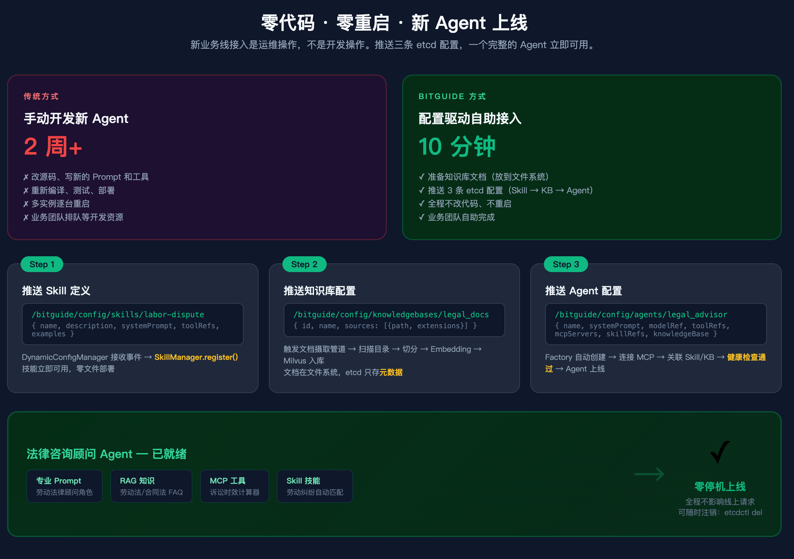
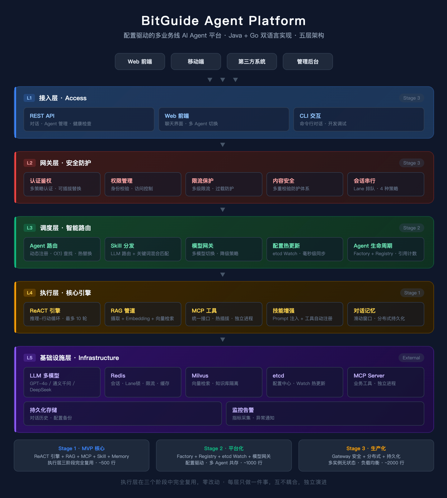
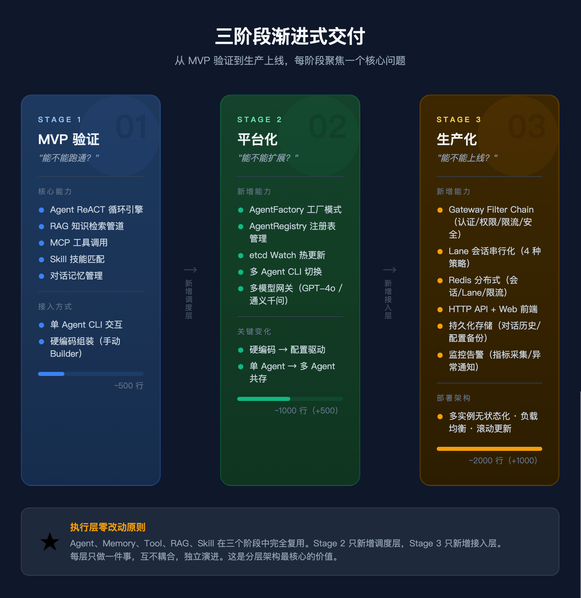

# 第1章 项目概述

## 1.1 项目背景

公司有多个业务部门，每个部门都有大量专业知识文档和频繁的客户/内部咨询需求。传统的人工服务模式存在两个瓶颈：**响应速度慢**、**知识覆盖不全**。

2024 年，公司决定建设 **AI Agent 平台**来解决这些问题：

- 各业务部门可自助配置专属 Agent，快速上线智能问答服务

- Agent 具备专业知识检索、实时工具调用、多轮对话等能力

- 平台本身具备多 Agent 管理、动态扩展、安全防护等企业级能力

> **平台的本质是通用的**。它是一个**配置驱动的 Agent 管理基础设施**，与具体业务完全解耦。接入新业务线只需要：准备知识库文档 → 配置 MCP 工具 → 定义 Skill → 推送 Agent 配置，整个过程项目平台代码零改动，也不用重新部署，不影响线上环境。
> 
> 本文档后续会用"教育咨询 / 法律咨询 / 投资助手"作为**演示场景**来讲解架构和实现。但请记住——这些场景是可以替换的。电商客服、医疗问诊、IT 服务台、金融风控、 HR 政策咨询……任何"有知识库 + 需要智能问答"的业务，都是同一个平台的不同配置。
> 
> 

经过技术选型评估，确定了 **"商业 LLM API + MCP 工具协议 +Skills+ 向量知识库 + 配置中心"** 的技术路线：

- **LLM 多模型网关**：不同业务场景对模型能力要求不同，支持按场景路由不同模型（如专业咨询用 GPT-4o，日常问答用通义千问）

- **MCP 工具协议**：将工具层与平台层解耦，业务团队可独立开发维护工具服务

- **etcd 配置中心**：基于 Watch 机制实现 Agent/Skill/知识库的运行时热更新

## 1.2 平台概览

**BitGuide Agent Platform** 是一个支持多业务线、配置驱动的 AI Agent 平台。核心架构如下：



### 平台核心能力

| 能力 | 说明 |
| --- | --- |
| **多 Agent 管理** | 工厂模式 + 注册表模式，支持同时运行多个不同领域的 Agent |
| **多模型网关** | 不同业务场景路由不同 LLM（GPT-4o / 通义千问 / 智谱等），支持按需切换和降级 |
| **配置驱动** | Agent/Skill/知识库均通过 YAML 配置或 etcd 动态管理，无需改代码 |
| **动态热更新** | 基于 etcd Watch 实现 Agent/Skill/知识库的运行时增删改，无需重启 |
| **RAG 知识检索** | 文档切分 → Embedding → Milvus 向量存储 → 相似度检索 → 增强生成 |
| **MCP 工具集成** | 支持 stdio 和 HTTP 两种传输方式，业务工具可热插拔 |
| **Skill 技能系统** | Prompt + 工具编排的专业能力包，支持 LLM 路由 + 关键词混合匹配 |
| **生产级网关** | API Key 认证、Prompt 注入检测、敏感词过滤、令牌桶限流 |
| **分布式就绪** | Redis 分布式会话、分布式限流、分布式 Lane，支持多实例部署 |

### 技术选型

| 组件 | 选型 | 选择理由 |
| --- | --- | --- |
| LLM | GPT-4o / 通义千问 / 智谱（多模型） | 不同业务场景对推理能力和成本的要求不同，多模型网关支持按需路由 |
| Embedding | text-embedding-3-large / 通义 text-embedding | 商业 Embedding API，维度高、语义表达能力强 |
| 向量数据库 | Milvus | 开源、高性能，支持大规模向量检索 |
| 配置中心 | etcd | Watch 机制天然支持热更新，Kubernetes 生态通用 |
| 分布式缓存 | Redis | 成熟方案，支持分布式锁、限流、会话共享 |
| 工具协议 | MCP（Anthropic） | 行业标准，工具与平台解耦，支持独立部署 |
| 开发语言 | Java 17+ / Go 1.22+ / Python 3.11+ | Java、Go 和 Python 是三种并列实现，可按团队技术栈或个人学习方向选择；各版本采用对应语言的原生工程方式。 |

> **开发环境说明**：本地开发调试时，可使用 Ollama 运行开源模型（如 qwen2.5）替代商业 API，降低开发成本。平台通过统一的 OpenAI 兼容接口适配，切换模型只需修改配置。

## 1.3 三阶段迭代

平台采用**渐进式交付**策略，分三个迭代上线：



### 迭代一：技术验证

选择一个业务场景作为 MVP（本文以教育咨询为例），验证 Agent 核心闭环是否可行：

- LLM API 对话质量是否满足业务要求

- 工具调用是否稳定

- RAG 知识检索效果是否达标

- Skill 技能系统是否能提升专业度

> 迭代一上线后，在试点业务线内灰度运行了 2 周，验证了技术路线可行性。

### 迭代二：平台化

MVP 验证通过后，多个业务部门提出了接入需求。迭代一的单 Agent 硬编码架构无法支撑——于是启动平台化改造：

- **工厂模式**：通过配置文件创建 Agent，新业务线接入无需改代码

- **动态热更新**：基于 etcd Watch，Agent/Skill/知识库均可运行时增删

- **多模型支持**：不同业务线可选用不同的 LLM 模型

> 迭代二完成后，3 个业务线在一周内完成了 Agent 接入，证明了配置驱动架构的有效性。

### 迭代三：生产上线

迭代二具备功能完整性，但面向生产环境还缺少关键保障：

- **认证鉴权**：无 API Key 校验，任何人都可调用

- **安全防护**：无 Prompt 注入检测，恶意输入可绕过限制等等

- **限流保护**：无流量控制，单个用户可打爆服务

- **HTTP 接入**：只有 CLI，无法对接前端和第三方系统

迭代三加入网关层，补齐全部生产级能力：

```Plaintext
请求 → AuthFilter（认证）→ SecurityFilter（安全）→ RateLimitFilter（限流）→ Agent 处理
```

> 迭代三上线后，平台正式接入公司 API 网关，通过 Web 界面向业务线开放。

## 1.4 技术栈总览

| 维度 | Java 版本 | Go 版本 | Python 版本 |
| --- | --- | --- | --- |
| **语言** | Java 17+ | Go 1.22+ | Python 3.11+ |
| **LLM 框架** | LangChain4j 0.36 | go-openai（OpenAI 兼容） | OpenAI Python SDK（OpenAI 兼容） |
| **Web 框架** | Spring Boot 3.2 | net/http（标准库） | FastAPI + Uvicorn |
| **配置中心** | jetcd + Jackson | etcd client/v3 + Viper | httpx（etcd v3 HTTP/JSON）+ Pydantic + PyYAML |
| **向量数据库** | Milvus SDK | Milvus SDK | pymilvus |
| **分布式缓存** | Jedis | go-redis | redis-py |
| **构建工具** | Maven | go build | uv + pyproject.toml |
| **并发模型** | synchronized / AtomicReference | sync.Map / atomic / channel | asyncio / Semaphore / Lock |

平台提供 Java、Go 和 Python 三种并列实现，共享同一套架构目标与阶段能力；代码组织、依赖管理和并发模型采用各语言的原生方式。

> 环境搭建、运行命令和代码走读分别放在 Java、Go、Python 实战中。请选择一种实现作为主线，此处只需先了解技术栈全貌。

---

## 小结

本章概述了 BitGuide Agent Platform 的建设背景和技术全貌：

- **业务驱动**：面向任意业务线的 AI 知识服务需求，驱动平台从单场景 MVP 演进到多 Agent 生产平台。场景可替换，架构通用

- **三阶段迭代**：技术验证 → 平台化（配置驱动 + 动态热更新）→ 生产上线（网关 + 安全 + 分布式）

- **技术选型**：多模型 LLM 网关（按场景路由）+ MCP（工具解耦）+ etcd（动态配置）+ Milvus/Redis（生产级存储）

- **三语言实现**：Java、Go 和 Python 三种并列实现，共享架构目标与阶段能力，适配不同技术栈团队

下一章将介绍平台涉及的核心技术概念。
