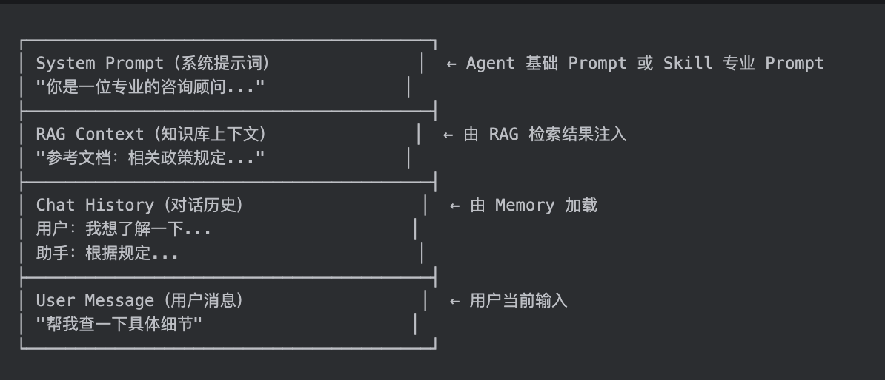
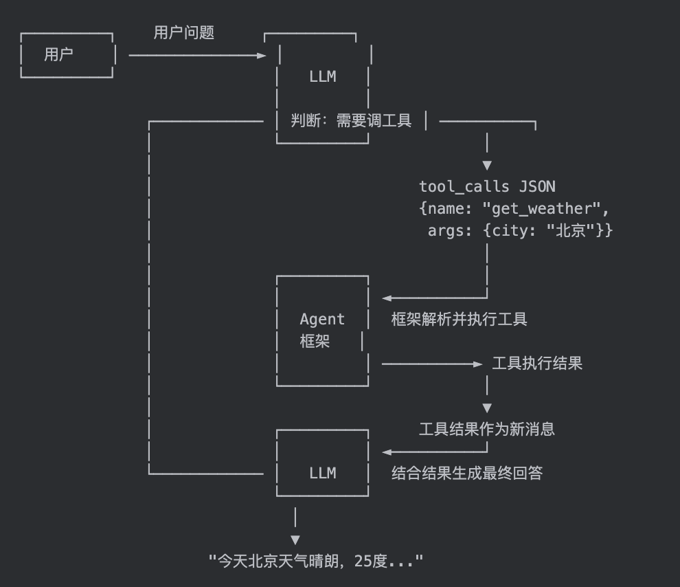

# 第2章 核心概念 —— Agent 平台的技术基础

要理解 BitGuide Agent Platform 的设计，需要先掌握 Agent 领域的核心概念。本章按照**一个请求在 Agent 中的处理顺序**来编排——你跟着请求流转，自然理解每个概念的定位和作用。

> 本章会用平台中的具体实现作为演示示例。和第 1 章一样，示例场景可以替换——概念本身与业务无关。

---

## 2.1 Agent 架构全景

### Agent = LLM + Memory + Tool + Planning

普通 LLM 只能"说话"，Agent 能"做事"。区别在于 Agent 给 LLM 配上了四个关键组件：

| 组件 | 定位 | 作用 |
| --- | --- | --- |
| **LLM** | 推理引擎 | 理解用户意图、生成回复、决定下一步行动 |
| **Memory** | 上下文管理 | 记住对话历史，维持多轮对话连贯性 |
| **Tool** | 外部能力 | 调用外部系统获取实时数据、执行操作。这里Tool算是抽象概念，可以囊括MCP+RAG等 |
| **Planning** | 决策循环 | 多步推理，决定"先做什么、再做什么"（ReACT 模式） |

```Plaintext
普通 LLM：
  用户提问 → LLM 回答（只能基于训练数据）

Agent：
  用户提问 → Skill匹配 → RAG检索 → 加载Memory → ReACT循环(推理→调工具→观察) → 回答
```

> 上面的流程提到了 Tool、Skill、RAG，后续章节还会出现 Function Calling、MCP、内置工具——这些概念经常被混为一谈。在深入之前，先厘清它们的关系：

| 概念 | 一句话定位 | 关键区分 |
| --- | --- | --- |
| Tool（工具） | Agent 可调用的外部能力函数 | 内置工具（calculator）+ MCP 工具（业务系统），两类来源，统一接口 |
| Function Calling | LLM 表达"我要调工具"的输出格式 | 不是工具本身，是 LLM → 框架的调用语法 |
| MCP | 连接外部工具的传输协议 | 不是工具本身，是工具的接入通道（类比 USB 之于外设） |
| RAG（知识检索） | 框架自动检索知识并注入 Prompt 上下文 | 不是 Tool——LLM 不会主动"调 RAG"，是框架在 LLM 看到问题之前就注入的 |
| Skill（技能） | 专业 Prompt + 推荐工具的场景增强包 | 不是 Tool——是一套"方案"（换 Prompt + 注册工具），不是单个能力函数 |

> 一句话记忆：**Function Calling 是语法，MCP 是通道，Tool 是能力，RAG 是知识注入，Skill 是场景增强**。
> 
> 这些概念在后续各节会分别展开：Function Calling 见 §2.2，ReACT 循环见 §2.3，Memory 见 §2.4，Tool 与 MCP 见 §2.5，RAG 见 §2.6，Skill 见 §2.7。

### Agent vs 普通聊天机器人

| 维度 | 聊天机器人 | Agent |
| --- | --- | --- |
| 信息来源 | 只有训练数据 | 训练数据 + 实时工具 + 知识库 |
| 能力 | 只能回答问题 | 能调用工具、执行操作 |
| 记忆 | 无状态或简单上下文 | 完整多轮对话记忆 |
| 决策 | 被动回答 | 主动规划、多步推理 |
| 本质 | 单轮问答系统 | 具备自主决策能力的执行引擎 |

> **工程意义**：这四个组件就是 Agent 平台的"最小可行架构"。BitGuide 的三阶段迭代，本质上就是围绕这四个组件逐步增强——迭代一跑通闭环，迭代二用工厂模式批量组装，迭代三加网关保护。

接下来的各节将逐个拆解这些组件。。

---

## 2.2 LLM 与 Function Calling

### LLM 在 Agent 中的角色

LLM（Large Language Model）是 Agent 的推理引擎。在 Agent 场景下，它不再只是"回答问题的聊天机器人"，而是承担三个职责：

1. **理解意图**：解析用户输入，判断需要做什么

1. **决策规划**：决定是否需要调用工具、调哪个工具、传什么参数

1. **生成回答**：综合工具返回结果和知识库内容，组织最终回复

### System Prompt 设计

每个 Agent 在配置时就定义了基础 System Prompt，设定角色和行为规范：

```YAML
# Agent 配置示例
agent:
  id: education_advisor
  systemPrompt: "你是一位专业的教育咨询顾问..."
  modelRef: gpt4o
```

当用户请求命中某个 Skill 时，Skill 的专业 Prompt 会**替换**基础 System Prompt，使 Agent 在该场景下具备专家级表现（详见 §2.7）。

最终发送给 LLM 的完整 Prompt 结构如下：



System Prompt 的设计要点：

- **角色定义**：明确 Agent 是谁、擅长什么

- **行为约束**：规定什么能做、什么不能做

- **输出格式**：定义回复的结构和风格

- **工具使用指引**：指导何时调用哪个工具

> **工程考量**：System Prompt 是影响 Agent 表现最大的单一因素。同样的 LLM、同样的工具，Prompt 质量不同，效果天差地别。常见的优化手段：

- **结构化模板**：将 Prompt 拆分为角色定义、能力范围、工具使用规则、输出格式四个固定段落，避免遗漏

- **Few-shot 示例**：在 Prompt 中嵌入 2-3 个典型问答样例，让 LLM 明确预期行为

- **迭代调优**：收集线上 bad case，针对性补充约束条款（如"不要回答超出范围的问题"）

> 平台通过 Skill 系统实现了 Prompt 的专业化管理——每个业务场景有独立的专业 Prompt 模板，由 SkillManager 按需加载。

### Function Calling：LLM 与工具的桥梁

这是 Agent 开发中**最关键也最容易忽略的概念**。LLM 本身不会"调用工具"——它只能生成文本。Function Calling 是 LLM 的一种特殊输出模式：

```Plaintext
普通对话：
  用户 → LLM → "今天北京天气晴朗..."

Function Calling 模式：
  用户 → LLM → {
    "tool_calls": [{
      "function": {
        "name": "get_weather",
        "arguments": "{\"city\": \"北京\"}"
      }
    }]
  }
```

**完整流程**：

```Plaintext
1. 开发者在请求中声明可用工具列表（工具名、参数 schema、功能描述）
2. LLM 判断需要调用工具时，不输出普通文本，而是输出结构化的 tool_calls JSON
3. Agent 框架解析 tool_calls，执行对应工具，获得结果
4. 将工具结果作为新消息发回 LLM
5. LLM 结合工具结果生成最终回答
```



> **关键理解**：Function Calling 不是 MCP。Function Calling 是 LLM 的**输出格式**（LLM 说"我要调这个工具"），MCP 是工具的**连接协议**（Agent 怎么找到并执行工具）。两者配合才完成一次完整的工具调用。

---

## 2.3 ReACT：Agent 的决策循环

### 为什么需要循环

单次 Function Calling 只能调一个工具。但实际业务中，用户一个问题可能需要多步推理：

```Plaintext
用户："这周末适合带 3 岁的孩子去户外活动吗？"

需要的信息：
  1. 这周末天气 → 调天气工具
  2. 孩子 3 岁，适合什么活动 → 查知识库

这两步有依赖关系：先知道天气，才能判断是否适合户外
```

### ReACT 模式

ReACT（Reasoning + Acting）是 Agent 的核心决策模式——循环执行"思考→行动→观察"，直到信息充分：

```Plaintext
用户输入："这周末适合带孩子去户外活动吗？"
                │
                ▼
        ┌─── Think ────────────────────┐
        │ 需要知道：                      │
        │ 1. 周末天气（需要调工具）       │
        │ 2. 孩子年龄（需要调工具）       │
        └──────────┬───────────────────┘
                   │
                   ▼
        ┌─── Act ─────────────────────┐
        │ 调用 get_weather("北京")      │
        │ 调用 age_calculator(...)      │
        └──────────┬───────────────────┘
                   │
                   ▼
        ┌─── Observe ─────────────────┐
        │ 天气：晴，25°C               │
        │ 年龄：3 岁 2 个月            │
        └──────────┬───────────────────┘
                   │
                   ▼
        ┌─── Think ────────────────────┐
        │ 信息足够，结合知识库组织回答   │
        └──────────┬───────────────────┘
                   │
                   ▼
    "这个周末天气很好，25 度晴天，孩子 3 岁多，
     非常适合户外探索活动..."
```

在 BitGuide 中，这个循环由 `BaseAgent.chatWithTools()` 实现，最多循环 10 次。每轮循环中：

1. LLM 根据当前信息决定下一步（Think）

1. 如果需要工具，通过 Function Calling 发起调用（Act）

1. 工具结果注入上下文，进入下一轮（Observe）

1. 如果 LLM 认为信息充分，直接输出文本回答，循环结束

> **工程考量**：循环次数上限是必要的保护——防止 LLM 陷入死循环（比如反复调用同一个工具但参数错误）。常见的防护策略：

- **硬上限**（平台默认）：最多 10 轮，超出直接终止并返回已收集的信息

- **重复检测**：如果连续 2 轮调用同一个工具且参数相同，强制跳出循环

- **超时控制**：为整个 ReACT 循环设置总超时时间，防止长时间占用资源

---

## 2.4 Memory：对话记忆

### 为什么 Agent 需要记忆

没有记忆的 Agent 是"金鱼"——每次对话都从零开始：

```Plaintext
用户：我想咨询一下 3 岁孩子的教育问题
Agent：好的，3岁是一个关键的发展阶段...

用户：那具体有哪些推荐活动？  ← Agent 知道"3岁"这个上下文吗？
```

Memory 的作用是维护对话上下文，让 Agent 能理解指代（"那"、"具体"指什么）和延续之前的讨论。

### Memory 的实现方式

业界常见的对话记忆方案，各有适用场景：

| 方案 | 原理 | 优点 | 局限 | 适用场景 |
| --- | --- | --- | --- | --- |
| **内存存储** | 对话历史保存在进程内存中 | 零延迟，零依赖 | 进程重启丢失，不支持多实例 | 单实例开发调试 |
| **Redis** | 对话历史存入 Redis（KV 或 Hash） | 低延迟，支持 TTL 过期，支持多实例 | 需要额外运维 Redis | 多实例生产部署 |
| **数据库持久化** | 对话历史写入 MySQL / PostgreSQL | 持久可靠，支持复杂查询和审计 | 读写延迟较高 | 需要长期存档、合规审计 |
| **向量记忆** | 对话摘要 Embedding 后存入向量库 | 支持语义检索历史对话 | 实现复杂，有信息损失 | 超长对话的语义回溯 |

> **面试常见问题**："多轮对话的记忆怎么实现？" 回答思路：先说方案选型（内存 vs Redis vs 数据库），再说窗口管理（截断策略），最后提优化思路（摘要压缩、分级存储）。

**本项目的实现**：

| 部署模式 | 实现方式 | 说明 |
| --- | --- | --- |
| 单实例（开发） | ConversationMemory | 基于内存的滑动窗口，零依赖 |
| 多实例（生产） | DistributedMemory | 基于 Redis，跨实例共享，支持 TTL 自动过期 |

### Token 窗口管理

LLM 的上下文窗口有限（如 8K / 32K Token）。对话轮次越多，历史越长，终会超出上限。Memory 需要做**截断策略**：

```Plaintext
第 1 轮：System Prompt + 用户消息 + Agent 回复           → ~500 Token
第 5 轮：System Prompt + 10 条历史 + RAG上下文 + 新消息   → ~3000 Token
第 15 轮：System Prompt + 30 条历史 + RAG上下文 + 新消息  → 可能超限！
```

平台的截断策略：保留最近 N 轮对话，更早的历史丢弃。N 的取值取决于模型窗口大小和单轮平均 Token 消耗。

> **工程考量**：Token 窗口管理直接影响用户体验和成本。常见的优化策略：

- **滑动窗口**（平台默认）：保留最近 N 轮，简单有效，但会丢失早期重要信息

- **摘要压缩**：将早期对话用 LLM 压缩成一段摘要，节省 Token 同时保留关键信息。代价是额外的 LLM 调用开销

- **分级存储**：最近 5 轮完整保留，6-20 轮压缩为摘要，20 轮之前写入数据库归档。兼顾上下文质量和成本

- **动态调整**：根据当前 Prompt + RAG 上下文的实际 Token 占用，动态计算还能塞多少轮对话历史

### 分布式会话

当平台部署多个实例时，用户的请求可能被负载均衡到不同实例。如果会话数据只存在内存里，其他实例无法读取——对话就断了。

```Plaintext
实例 A ← 用户第 1 轮请求（会话数据在内存）
实例 B ← 用户第 2 轮请求（读不到实例 A 的会话数据！）
```

解决方案：将会话数据存入 Redis，所有实例共享：

```Plaintext
实例 A ← 用户请求 → 读写 Redis 会话
实例 B ← 用户请求 → 读写 Redis 会话
实例 C ← 用户请求 → 读写 Redis 会话
                  ↘ 都是同一个 Redis ↙
```

---

## 2.5 Tool 与 MCP

### Tool（工具）

Tool 是 Agent 连接外部世界的能力接口。没有 Tool 的 Agent 只能基于训练数据回答，有了 Tool 就能获取实时数据、执行操作。

```Plaintext
Tool 定义示例：
┌────────────────────────────────────┐
│ 名称：age_calculator               │
│ 描述：根据出生年月计算精确年龄     │
│ 参数：birth_year (int)             │
│       birth_month (int)            │
│ 返回：精确年龄和发展阶段建议       │
└────────────────────────────────────┘
```

工具通过 Function Calling 机制被 LLM 调用（见 §2.2）。LLM 看到工具的名称、描述和参数 schema，在需要时自动发起调用。

### MCP（Model Context Protocol）

> 理解：MCP 是 Anthropic 提出的工具连接标准。类比 USB 统一了外设接口，MCP 统一了 Agent 调用外部工具的协议——一个标准对接所有工具。

**没有 MCP 的时候：**

```Plaintext
要加一个天气工具 → 写一个 WeatherTool 类，改平台代码，重新部署
要加一个股票工具 → 写一个 StockTool 类，改平台代码，重新部署
→ 每个工具都侵入平台代码
```

**有了 MCP 之后：**

```Plaintext
要加一个天气工具 → 修改育儿领域 MCP Server（独立进程）增加一个工具，平台配置文件里加一行
要加一个股票工具 → 修改股票领域 MCP Server（独立进程）增加一个工具，平台配置文件里加一行
→ 不改平台代码，不重启服务
```

MCP Server 是独立进程，通过 JSON-RPC 协议与 Agent 通信，支持两种传输方式：

```Plaintext
┌──────────┐    JSON-RPC     ┌──────────────┐
│  Agent          │ ◄───────►  │   MCP Server          │
│ (Client)        │   stdio 管道    │  (工具提供者)           │
│                 │   或 HTTP SSE   │                       │
└──────────┘                 └──────────────┘    
```

> **工程意义**：MCP 的核心价值是**解耦**。工具提供者只需按 MCP 协议实现 Server，不关心调用方是谁。这正是微服务架构中"协议标准化"思想在 AI 领域的体现。面试中可以说：MCP 之于 Agent，相当于 REST API 之于微服务。

### 平台中的工具分类

| 类型 | 示例 | 特点 |
| --- | --- | --- |
| **内置 Tool** | Calculator、DateTime | 平台通用，与业务无关，代码内置 |
| **MCP Tool** | 天气查询、年龄计算、股票行情 | 业务相关，外部进程，可热插拔 |

---

## 2.6 RAG：知识检索增强

> 理解：RAG（Retrieval-Augmented Generation）的本质是"先检索、再生成"——先从知识库中找到相关内容，再让 LLM 基于参考内容生成回答，避免"凭空编造"。

### 为什么需要 RAG

LLM 的知识来自训练数据，存在两个局限：

1. **知识有时效性**：训练数据截止于某个时间点，无法获取最新信息

1. **缺少私有知识**：公司内部文档、业务手册、行业知识，LLM 完全不了解

RAG 的解决方案：在回答之前，先从知识库中检索相关内容，作为参考信息喂给 LLM。

### RAG 工作流程

```Plaintext
                 用户提问
                    │
                    ▼
          ┌─────────────────┐
          │  1. 检索 Retrieve           │  ← 在知识库中搜索相关文档片段
          └────────┬────────┘
                   │
                   ▼
          ┌─────────────────┐
          │  2. 增强 Augment            │  ← 把检索结果拼接到 Prompt 中
          └────────┬────────┘
                   │
                   ▼
          ┌─────────────────┐
          │  3. 生成 Generate           │  ← LLM 结合参考内容生成回答
          └────────┬────────┘
                   │
                   ▼
               最终回答
```

平台中的实际效果：用户问一个专业问题时，RAG 从知识库检索到相关文档段落，拼接到 Prompt 的 `RAG Context` 区域（见 §2.2 的 Prompt 结构图）。LLM 看到参考内容后，给出基于专业知识的回答而非泛泛而谈。

### RAG 的三个关键环节

**环节一：文档切分**

长文档必须切成小片段才能精准检索。切分策略直接影响检索质量：

```Plaintext
一篇 10000 字的文档
├── 片段 1：0-500 字      ← 500 字/段，相邻片段重叠 50 字
├── 片段 2：450-950 字    ← 重叠确保上下文不丢失
├── 片段 3：900-1400 字
└── ...
```

| 参数 | 影响 | 平台默认值 |
| --- | --- | --- |
| 片段大小 | 太粗会混入无关内容，太细会丢失上下文 | 500 字/段 |
| 重叠大小 | 太小会切断语义，太大会重复存储 | 50 字 |

**环节二：Embedding（文本向量化）**

Embedding 模型把文本转换成高维数字向量。语义相近的文本，向量也相近：

```Plaintext
"3岁孩子发脾气怎么办"  →  [0.12, -0.34, 0.56, ..., 0.78]  ← 768维向量
"幼儿情绪管理方法"      →  [0.11, -0.33, 0.55, ..., 0.77]  ← 非常接近！
"今天天气怎么样"        →  [-0.45, 0.23, 0.11, ..., 0.02]  ← 差距很大
```

平台使用商业 Embedding API（如 text-embedding-3-large），本地开发可替换为 Ollama 的 `nomic-embed-text` 模型。

**环节三：向量检索**

向量数据库存储所有文档片段的 Embedding 向量，支持 KNN（K-Nearest Neighbors）搜索——给定一个查询向量，找出语义最接近的 Top-K 个文档片段。

```Plaintext
知识库文档（离线准备）                    用户提问（实时）
"相关规定条款..."                          "这个问题怎么处理"
       │                                       │
       ▼                                       ▼
  文档切分                                  Embedding
  (500字/段)                               (文本→向量)
       │                                       │
       ▼                                       ▼
  Embedding                               向量数据库
  (文本→向量)                              (KNN 搜索 Top 5)
       │                                       │
       ▼                                       ▼
  向量数据库                               检索结果
  (存储向量)                               "相关条款内容..."
                                                    │
                                                    ▼
                                              拼接到 Prompt
                                                    │
                                                    ▼
                                                LLM 生成回答
```

| 部署方式 | 适用场景 | 平台实现 |
| --- | --- | --- |
| 内存向量库 | 开发调试 | InMemoryVectorStore（零依赖） |
| Milvus | 生产环境 | 专业向量数据库，支持大规模数据和高并发检索 |

> **工程考量**：RAG 的质量取决于三个环节的配合——切分粒度、Embedding 模型能力、检索策略（Top-K 值、相似度阈值）。常见的调优方向：

- **切分策略**：按语义段落切分优于按固定字数切分；标题/段落等结构化信息应作为元数据保留

- **检索增强**：先用关键词检索粗筛，再用向量检索精排（混合检索）；对检索结果做重排序（Rerank）

- **效果评估**：建立召回率和准确率的评估数据集，每次调参后跑回归测试，避免盲目调优

---

## 2.7 Skill：技能系统

> 理解：Skill 是 Agent 的"专业能力包"——一套 Prompt + 工具编排的组合方案，让通用 Agent 在特定领域具备专家级表现。

### Skill 和 Tool 的区别

| 维度 | Tool（工具） | Skill（技能） |
| --- | --- | --- |
| 本质 | 一个函数（输入→输出） | 一套专业方案（Prompt + 工具编排） |
| 粒度 | 原子操作 | 复合能力 |
| 例子 | `get_weather()` 返回天气数据 | "根据天气和孩子年龄推荐户外活动" |
| 平台中的角色 | 内置工具+ MCP工具（MCP Server 提供） | SkillManager 管理，运行时可动态增删 |

### Skill 的工作流程

当用户发送一条消息时，Skill 系统的介入时机在 ReACT 循环**之前**：

```Plaintext
1. 匹配：SkillManager 根据用户输入，判断应该启用哪个 Skill
2. 注入工具：确保 Agent 有该 Skill 依赖的工具（如天气查询、年龄计算）
3. 替换 Prompt：用 Skill 的专业提示词替换默认 System Prompt
4. 执行：Agent 用专业 Prompt + 完整工具进入 ReACT 循环
```

```Plaintext
用户消息 → Skill匹配 → [匹配到技能]
                        ├── 替换 System Prompt
                        ├── 注入依赖的工具
                        └── 进入 ReACT 循环
           → [未匹配技能]
                        └── 使用默认 Prompt 进入 ReACT 循环
```

### Skill 的实现方式

| 方式 | 说明 | 适用阶段 |
| --- | --- | --- |
| **文件系统** | `skills/xxx/SKILL.md` 文件定义 | 迭代一（简单场景） |
| **etcd 动态注册** | 推送 JSON 到 etcd，运行时自动加载 | 迭代二+（多业务线） |

etcd 方式支持运行时增删 Skill，无需重启服务——这正是平台"配置驱动"架构的体现。

### Skill 匹配策略

| 策略 | 原理 | 特点 |
| --- | --- | --- |
| **关键词匹配** | 用关键词匹配技能名称和描述 | 快速但粗糙 |
| **LLM 路由** | 让 LLM 判断应该用哪个技能 | 准确但有额外开销 |
| **混合模式** | 先 LLM 路由，失败则关键词兜底 | 平台默认策略 |

---

## 2.8 全景串联：一个完整请求的端到端流转

现在把所有概念串起来，追踪一个完整请求在 BitGuide Agent Platform 中的流转：

```Plaintext
用户："我家孩子21年出生，周末去北京适合去哪玩？"
  │
  ▼
┌──────────────────────────────────────────────────────┐
│ 1. Skill 匹配                                        │
│    → 匹配到"活动推荐"技能                             │
│    → 注入天气查询、年龄计算等工具                     │
│    → 替换为专业的活动推荐 Prompt                      │
├──────────────────────────────────────────────────────┤
│ 2. RAG 检索                                          │
│    → 用户问题 Embedding → 向量库 KNN 检索             │
│    → 检索到相关文档片段                               │
│    → 拼接到 Prompt 的 RAG Context 区域                │
├──────────────────────────────────────────────────────┤
│ 3. Memory 加载                                       │
│    → 从会话存储加载对话历史                           │
│    → 拼接到 Prompt 的 Chat History 区域               │
│    → 如超出 Token 窗口，截断更早的历史                │
├──────────────────────────────────────────────────────┤
│ 4. ReACT 循环                                        │
│    ┌─ Think: 需要知道年龄                              │
│    ├─ Function Calling: LLM 输出 age_caculator           │
│    ├─ Act: 框架调用 age_caculator("21年出生“)          │
│    ├─ Observe: 工具返回 5岁                        │
      ├─ Think: 信息不足，还需要知道天气                   │
│    ├─ Function Calling: LLM 输出 tool_calls           │
│    ├─ Act: 框架调用 get_weather("北京")               │
│    ├─ Think: 信息足够，生成推荐                        │
│    └─ LLM 输出最终文本回答                             │
├──────────────────────────────────────────────────────┤
│ 5. Memory 存储                                       │
│    → 本轮对话存入会话存储                             │
│    → 下次对话时自动加载                               │
└──────────────────────────────────────────────────────┘
  │
  ▼
回复："这个周末天气晴朗，25度，非常适合带孩子去
      户外活动。5岁的孩子正处于探索欲旺盛的阶段，
      推荐去..."
```

### 各概念在流转中的角色

| 概念 | 角色 | 在流程中的位置 | 对应章节 |
| --- | --- | --- | --- |
| **LLM** | 推理引擎 | 每次推理和生成都依赖它 | §2.2 |
| **System Prompt** | 角色定义 | 由 Skill 注入，定义 Agent 行为 | §2.2 |
| **Function Calling** | 工具调用协议 | LLM 输出 tool_calls，框架执行 | §2.2 |
| **ReACT** | 决策模式 | Think → Act → Observe 循环 | §2.3 |
| **Memory** | 上下文管理 | 请求前加载历史，请求后保存对话 | §2.4 |
| **Tool** | 外部能力 | ReACT 循环中按需调用 | §2.5 |
| **MCP** | 工具协议 | Tool 的连接和发现机制 | §2.5 |
| **RAG** | 知识检索 | 请求前检索相关知识 | §2.6 |
| **Skill** | 专业能力 | 请求前匹配并注入 Prompt + 工具 | §2.7 |

---

## 小结

本章按照请求在 Agent 中的处理顺序，介绍了平台涉及的全部核心技术概念：

1. **Agent 架构**：LLM + Memory + Tool + Planning，这是平台级 Agent 的最小可行架构

1. **LLM 与 Function Calling**：LLM 通过 System Prompt 定义角色，通过 Function Calling 输出结构化的工具调用请求

1. **ReACT 循环**：Agent 的核心决策模式——Think → Act → Observe，多步推理直到信息充分

1. **Memory**：管理对话上下文，处理 Token 窗口截断，生产环境使用 Redis 分布式会话

1. **Tool 与 MCP**：Tool 是 Agent 的外部能力接口，MCP 统一了工具的连接协议

1. **RAG**：知识检索增强，包含文档切分、Embedding 向量化、向量检索三个关键环节

1. **Skill**：Prompt + 工具编排的专业能力包，支持运行时动态注册

下一章将从架构层面展示这些概念是如何组织成一个完整的三阶段平台。
