# 第3章 架构设计

本章是整个平台的技术架构总览。目标：**一眼看清平台全貌——包含哪些模块、模块间如何协作、关键设计决策是什么**。

---

## 3.1 系统全景图

### 平台定位

BitGuide Agent Platform 是一个**面向多业务线的 AI Agent 运行与管理平台**。对上提供统一的 HTTP API 和 Web 管理界面，对下屏蔽 LLM、向量库、配置中心等基础设施的复杂性。

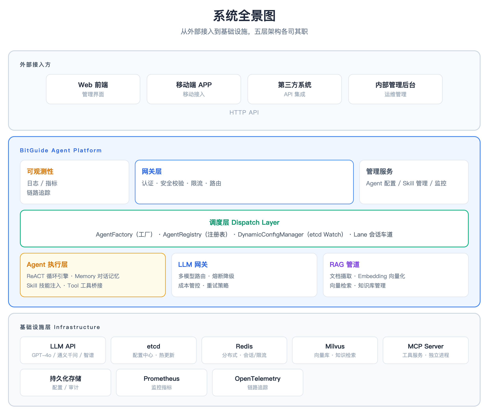

### 一眼看清平台能力

| 能力域 | 模块 | 做什么 |
| --- | --- | --- |
| **Agent 运行** | Agent Engine | ReACT 循环、Function Calling、多步推理 |
| **Agent 管理** | AgentFactory + AgentRegistry | 工厂创建、生命周期管理、引用计数安全更新 |
| **智能路由** | Skill Engine | LLM 路由 + 关键词混合匹配，动态注入 Prompt 和工具 |
| **知识检索** | RAG Pipeline | 文档切分 → Embedding → Milvus 存储 → 相似度检索 |
| **对话记忆** | Memory | 滑动窗口截断、Redis 分布式会话、Token 预算管理 |
| **工具集成** | Tool Bridge + MCP Client | 内置工具 + MCP 外部工具，stdio/HTTP 双传输 |
| **模型管理** | LLM Gateway | 多模型路由、熔断降级、重试、Token 成本统计 |
| **流量治理** | Gateway | 认证、安全检测、限流、会话车道 |
| **动态配置** | DynamicConfigManager | etcd Watch 驱动的 Agent/Skill/知识库热更新 |
| **可观测性** | Observability | 结构化日志、Prometheus 指标、OpenTelemetry 链路追踪 |
| **部署运维** | Deployment | Docker Compose 开发、Kubernetes 生产、 Helm Charts |

---

## 3.2 四层架构

平台采用四层架构，职责严格分离。三阶段迭代中，**执行层始终不变**，演进集中在接入层和调度层：

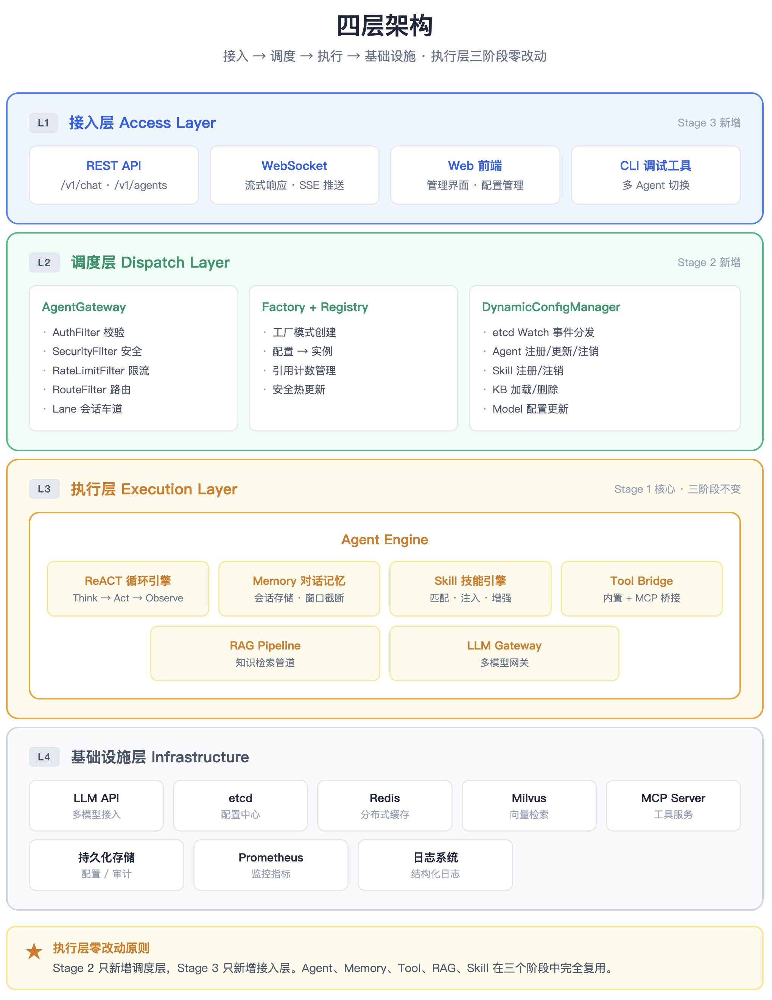

> **关键设计原则**：执行层在三个迭代中**完全不变**。迭代一 → 迭代二升级调度层，迭代二 → 迭代三升级接入层。Agent 本身不需要改。

---

## 3.3 核心模块设计

### Agent Engine —— Agent 运行引擎

Agent 的核心执行单元，采用 ReACT（Reasoning + Acting）循环模式：

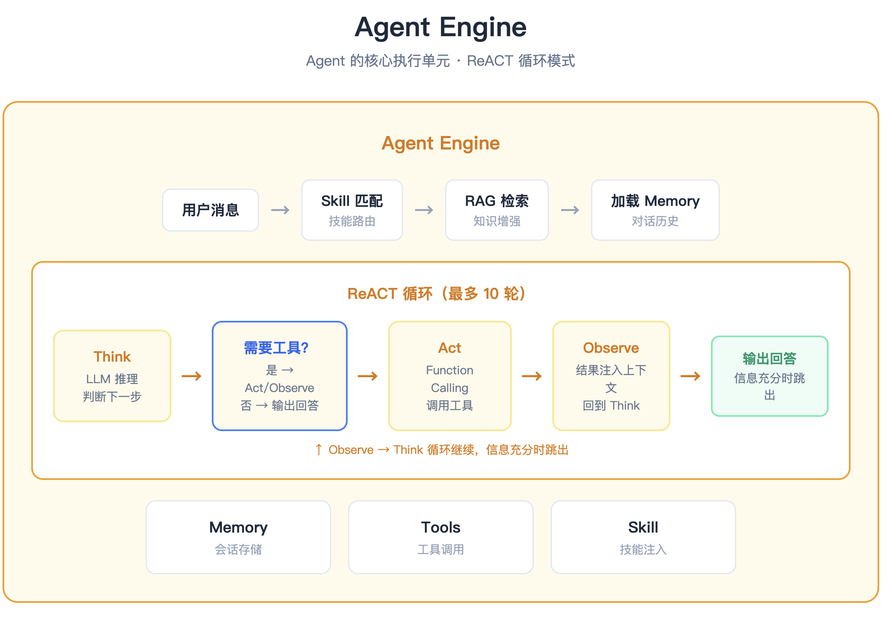

**关键设计决策**：

| 决策 | 方案 | 理由 |
| --- | --- | --- |
| Agent 构建 | Builder 模式 | 组件可选（RAG/Skill/MCP 均为可选），Builder 天然支持灵活组装 |
| 循环上限 | 默认 10 轮，可配置 | 防止 LLM 死循环；加上重复调用检测和总超时 |
| 工具调用协议 | Function Calling | LLM 原生支持，结构化输出 tool_calls JSON，框架解析执行 |
| 会话隔离 | userId:sessionId | 同一用户可有多个独立会话，互不干扰 |

### Agent Management —— Agent 管理体系

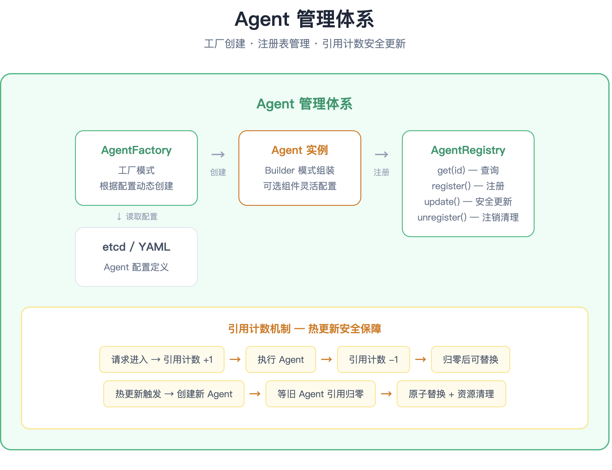

**引用计数机制**：Agent 热更新时的核心安全保障——正在处理请求的 Agent 不会被替换，等所有请求完成后才切换到新版本。实现方式：

```Plaintext
请求进入 → 引用计数 +1 → 执行 Agent → 引用计数 -1 → 归零后可替换
热更新时 → 创建新 Agent → 等旧 Agent 引用归零 → 原子替换 → 旧 Agent 资源清理
```

### LLM Gateway —— 多模型网关

不只是"调 API"，而是生产级的模型管理层：

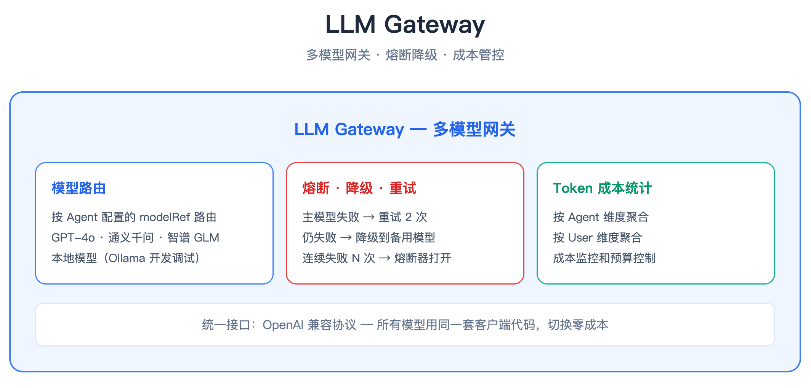

**关键设计决策**：

| 能力 | 方案 | 场景 |
| --- | --- | --- |
| **模型路由** | Agent 配置中指定 `modelRef`，运行时可切换 | 法律咨询用 GPT-4o，日常问答用通义千问 |
| **熔断降级** | 主模型连续失败 N 次后切换到备用模型 | GPT-4o 不可用时自动降级到通义千问 |
| **重试策略** | 指数退避重试，最多 3 次 | API 偶发超时或限流 |
| **成本统计** | 按 Agent 维度统计 Token 消耗 | 成本监控和预算控制 |
| **统一接口** | OpenAI 兼容协议 | 所有模型用同一套客户端代码，切换零成本 |

### RAG Pipeline —— 知识检索管道

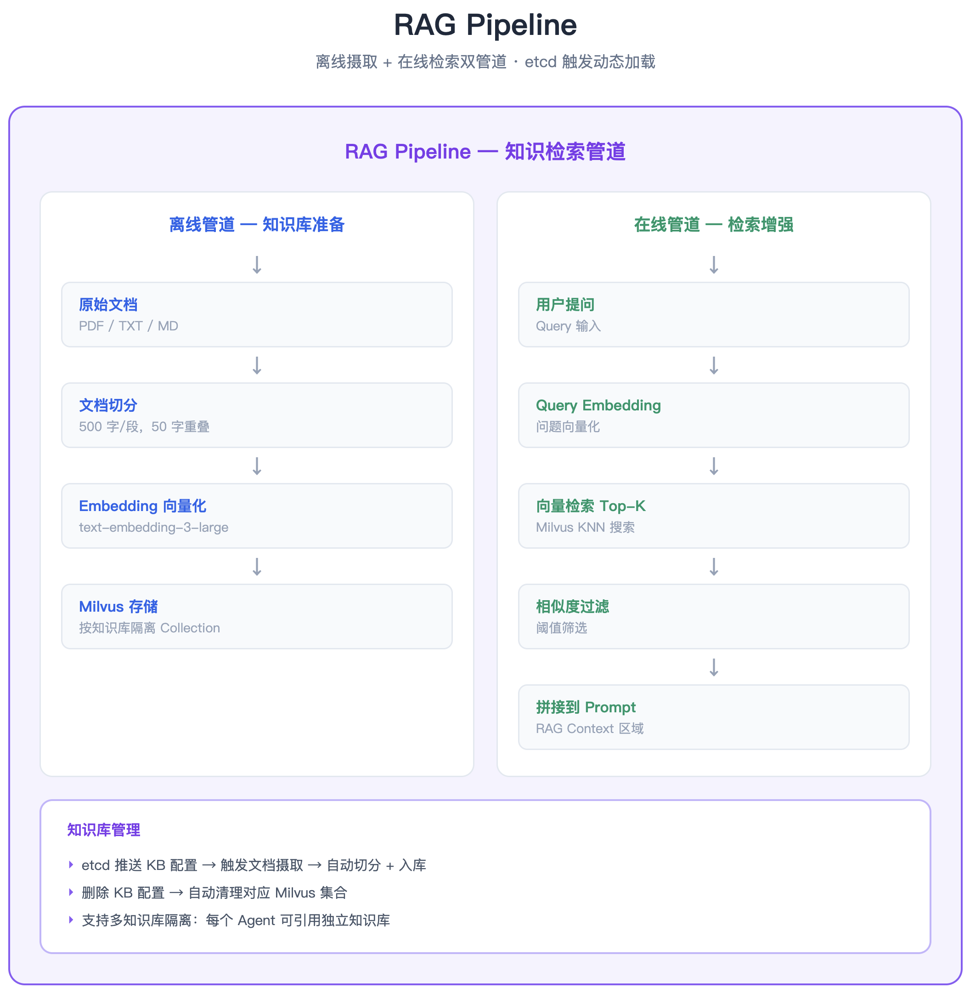

**关键设计决策**：

| 决策 | 方案 | 理由 |
| --- | --- | --- |
| 向量存储 | Milvus（生产）/ 内存（开发） | 开发零依赖，生产高性能 |
| 集合隔离 | 每个知识库一个 Milvus Collection | 支持按知识库独立管理和删除 |
| 检索策略 | KNN 向量检索 + 相似度阈值过滤 | Top-K 保证召回数量，阈值保证质量 |
| 动态加载 | etcd 推送配置触发文档摄取 | 新业务线接入知识库零代码、零重启 |

### Skill Engine —— 技能引擎

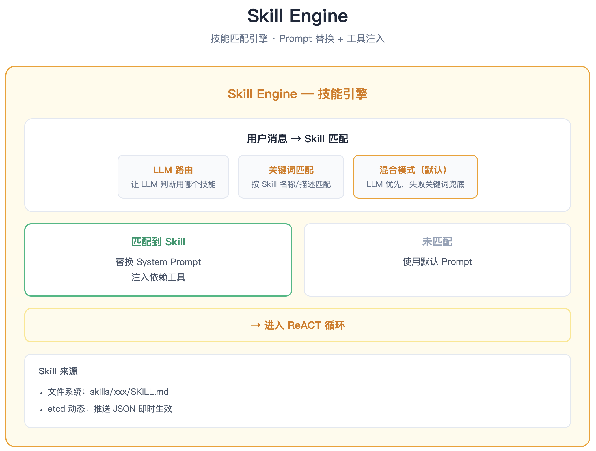

### Gateway —— 流量治理网关

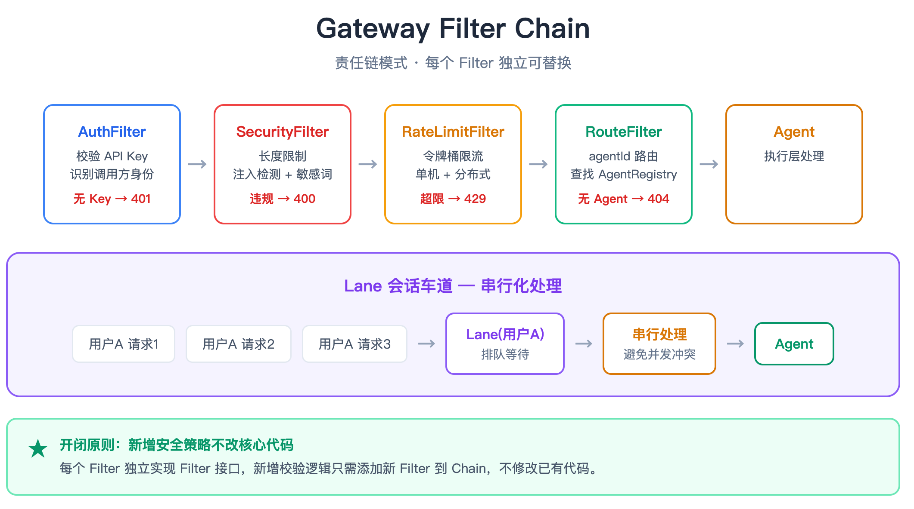

| **Filter** | **职责** | **实现方式** |
| --- | --- | --- |
| **AuthFilter** | API Key 认证，识别调用方身份 | Key 从 Header 读取，与配置比对 |
| **SecurityFilter** | Prompt 安全检测 | 长度限制 + 注入关键词检测 + 敏感词过滤 |
| **RateLimitFilter** | 限流保护 | 单机令牌桶 + Redis 分布式令牌桶 |
| **RouteFilter** | Agent 路由 | 按 userId + agentId 路由到对应 Agent 实例 |

**Lane 会话车道**：保证同一会话的请求串行处理，避免并发导致的上下文混乱。

```Plaintext
用户A 请求1 ──┐
用户A 请求2 ──┼──► Lane(用户A) ──► 串行处理 ──► Agent
用户A 请求3 ──┘     排队等待
```

### DynamicConfigManager —— 动态配置中心

基于 etcd Watch 的配置热更新，是平台"配置驱动"架构的核心：

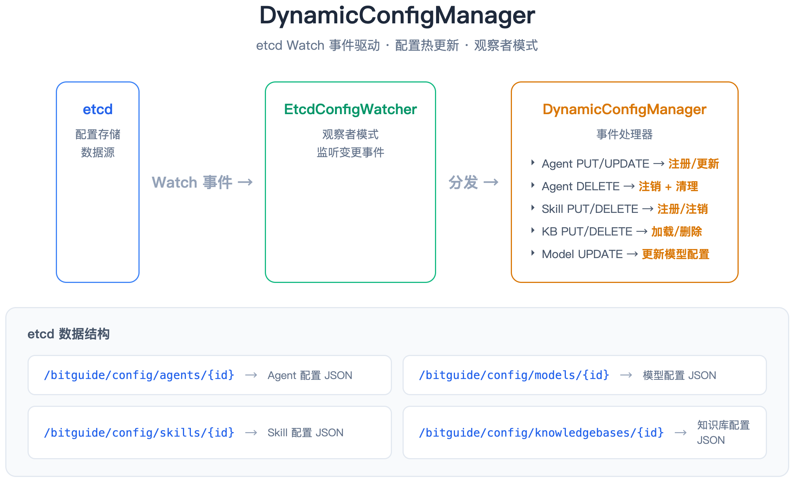

etcd 中的数据结构：

```Plaintext
/bitguide/config/agents/{agent_id}          → Agent 配置 JSON
/bitguide/config/models/{model_id}          → 模型配置 JSON
/bitguide/config/skills/{skill_id}          → Skill 配置 JSON
/bitguide/config/knowledgebases/{kb_id}     → 知识库配置 JSON
```

### Observability —— 可观测性

企业级系统的必备能力，贯穿所有层：

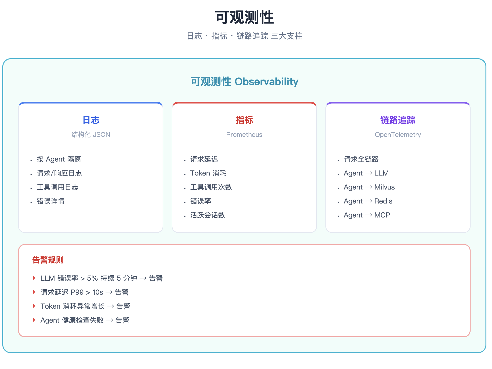

---

## 3.5 数据流：一个请求的端到端流转

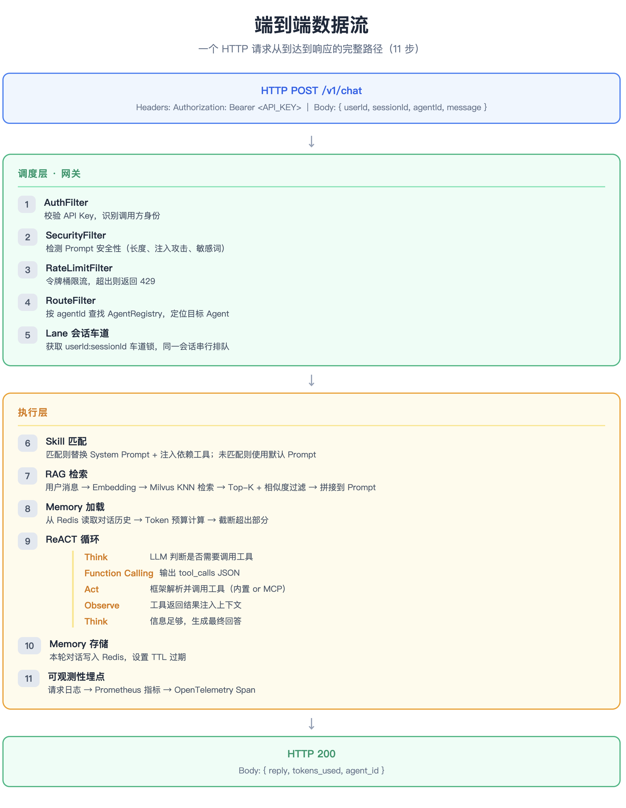

---

## 3.6 设计模式

设计模式不是炫技，而是解决特定问题的标准方案。平台中用到的每个模式都有明确的"解决的问题"：

### 构建阶段

| **模式** | **解决的问题** | **在哪里用** |
| --- | --- | --- |
| **Builder** | Agent 组件可选（RAG/Skill/MCP 不一定每个都有），需要灵活组装 | `BaseAgent.Builder` |
| **Factory** | 根据配置动态创建 Agent，避免到处 new 组件 | `AgentFactory` |
| **Registry** | 统一管理多个 Agent 的生命周期（注册/查询/更新/注销） | `AgentRegistry` |

### 运行阶段

| **模式** | **解决的问题** | **在哪里用** |
| --- | --- | --- |
| **Strategy** | Skill 匹配有多种策略（LLM路由/关键词/混合），需要可切换 | Skill 匹配策略 |
| **Chain of Responsibility** | 网关校验逻辑多且独立变化，需要可插拔 | Gateway FilterChain |
| **Bridge** | Tool 实现有两种来源（内置/MCP），但调用方式统一 | ToolBridge + MCP Client |

### 配置管理

| **模式** | **解决的问题** | **在哪里用** |
| --- | --- | --- |
| **Observer** | 配置变更需要即时生效，但轮询低效 | etcd Watch → DynamicConfigManager |
| **Reference Counting** | Agent 热更新时不能影响正在处理的请求 | AgentRegistry 引用计数 |

---

## 3.7 技术选型

每个选型都有明确的决策理由：

| **组件** | **选型** | **决策理由** |
| --- | --- | --- |
| **LLM** | GPT-4o / 通义千问 / 智谱 | 多模型网关，按场景路由不同能力等级的模型 |
| **Embedding** | text-embedding-3-large | 商业 API，维度高、语义表达能力强 |
| **向量库** | Milvus | 开源、高性能、支持 Collection 级隔离 |
| **配置中心** | etcd | Watch 机制天然支持热更新，K8s 生态通用 |
| **分布式缓存** | Redis | 分布式会话、分布式限流、分布式锁，一石三鸟 |
| **关系数据库** | PostgreSQL | Agent 配置版本管理、操作审计日志、对话历史归档 |
| **工具协议** | MCP | 行业标准，工具与平台解耦 |
| **监控** | Prometheus + Grafana | 指标采集和可视化的事实标准 |
| **链路追踪** | OpenTelemetry | 厂商中立，支持多语言 |
| **容器编排** | Kubernetes | 生产级部署，支持弹性伸缩和滚动更新 |

平台提供 Java、Go 和 Python 三种并列实现，共享同一套架构目标与阶段能力；具体工程组织采用各语言的原生方式：

### 三语言实现

| **维度** | **Java** | **Go** | **Python** |
| --- | --- | --- | --- |
| **语言** | Java 17+ | Go 1.22+ | Python 3.11+ |
| **LLM 框架** | LangChain4j 0.36 | go-openai（OpenAI 兼容） | OpenAI Python SDK（OpenAI 兼容） |
| **Web 框架** | Spring Boot 3.2 | net/http（标准库） | FastAPI + Uvicorn |

---

## 3.8 部署架构

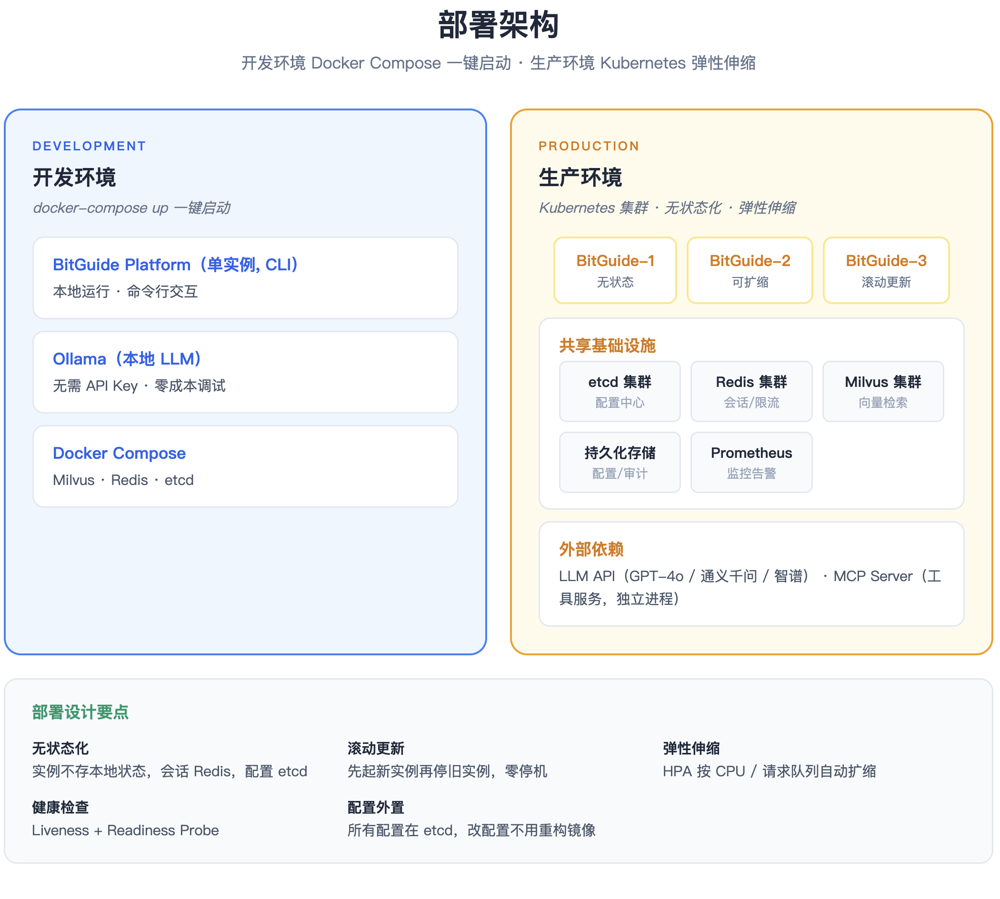

### 开发环境

```Bash
docker-compose up    # 一键启动 Milvus + Redis + etcd
```

### 生产环境

基于k8s （省略实现）

**部署设计要点**：

| 要点 | 方案 |
| --- | --- |
| **无状态化** | BitGuide 实例不存本地状态，会话在 Redis，配置在 etcd，支持水平扩缩 |
| **滚动更新** | Kubernetes RollingUpdate，先起新实例再停旧实例，零停机 |
| **健康检查** | Liveness Probe（进程存活）+ Readiness Probe（Agent 就绪） |
| **弹性伸缩** | HPA 按 CPU / 请求队列深度自动扩缩实例数 |
| **配置外置** | 所有配置在 etcd，不在镜像内，改配置不用重新构建 |

---

## 小结

本章从全局视角呈现了 BitGuide Agent Platform 的完整架构：

1. **四层架构**：接入 → 调度 → 执行 → 基础设施，职责清晰，执行层跨阶段不变

1. **核心模块**：Agent Engine、Agent Management、LLM Gateway、RAG Pipeline、Skill Engine、Gateway、DynamicConfigManager、Observability——覆盖运行、管理、治理、观测四个维度

1. **设计模式**：Builder/Factory/Registry/Strategy/Chain of Responsibility/Bridge/Observer/Reference Counting——每个模式解决一个具体的工程问题

1. **技术选型**：每个组件的选择都有明确的决策理由

1. **部署架构**：开发环境 Docker Compose 一键启动，生产环境 Kubernetes 弹性伸缩

接下来的三章将逐迭代深入每个模块的设计细节。
