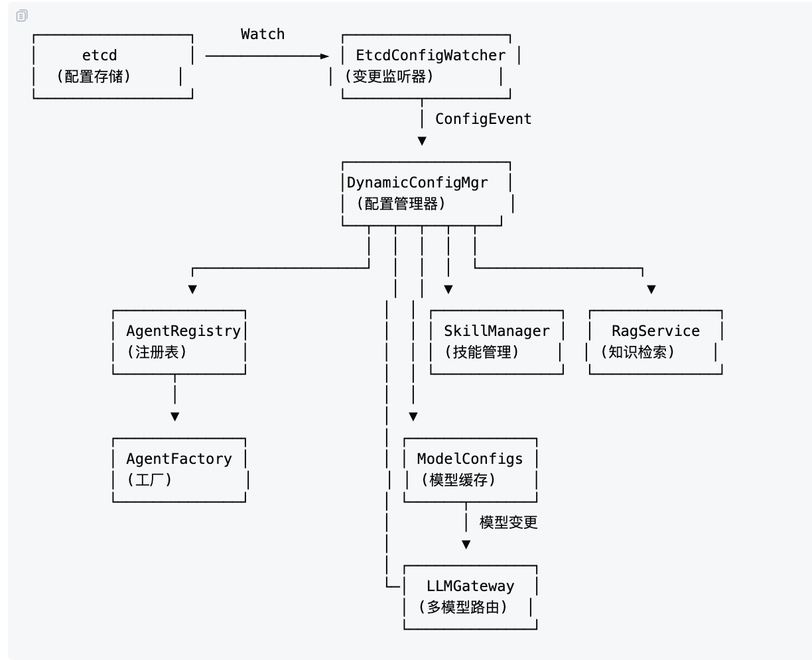

# 第5章 迭代二设计详解 —— 配置驱动的多 Agent 平台

迭代一证明了一个 Agent 能跑起来。但一个 Agent 只能服务一个业务场景。要接入新业务线，就得复制代码、改 Prompt、改工具列表、重新编译部署——这不可接受。

迭代二的目标：**让新业务场景接入变成"改配置"而不是"改代码"**。具体来说，就是用工厂模式替代手工组装、用注册表管理 Agent 生命周期、用 etcd Watch 实现运行时热更新。

---

## 5.1 从迭代一到迭代二的演进

### 迭代一的局限

| 局限 | 具体表现 | 迭代二的解决方案 |
| --- | --- | --- |
| **硬编码 Agent** | Agent 的 Prompt、工具、模型都写死在代码里 | 配置文件 + etcd 定义 Agent |
| **单 Agent** | 只能运行一个固定场景的 Agent | 支持多个 Agent 共存 |
| **改代码才能加场景** | 新业务线接入需要改源码、重新编译 | 写配置文件即可 |
| **无法动态更新** | 修改配置必须重启服务 | etcd 热更新，零停机 |
| **无 Agent 管理** | 没有 Agent 列表、切换、生命周期管理 | CLI 支持多 Agent 切换 |
| **Skill 静态加载** | Skill 只能从文件系统加载 | etcd 动态注册/注销 Skill |
| **RAG 手动配置** | 知识库需要手动准备和配置 | etcd 推送配置自动触发文档摄取 |

### 迭代二新增的架构层次

```Plaintext
迭代一（单 Agent 硬编码）
┌──────────────────────────────────────┐
│  应用启动入口                        │
│  ├── 手动创建每个组件                │
│  ├── 手动 Builder 组装 Agent         │
│  └── CLI 循环                        │
└──────────────────────────────────────┘
          │
          ▼ 演进
迭代二（配置驱动多 Agent）
┌──────────────────────────────────────┐
│  应用启动入口                        │
│  ├── 加载配置（YAML + etcd）         │
│  ├── AgentFactory 批量创建 Agent     │
│  ├── AgentRegistry 统一管理          │
│  ├── DynamicConfigManager 热更新     │
│  └── CLI（多 Agent 切换）            │
└──────────────────────────────────────┘
```

**关键原则**：迭代二只改了 Agent 的**创建和管理**方式，Agent 内部的执行逻辑（ReACT 循环、Tool、RAG、Skill、Memory）完全不变，和迭代一共用同一套 `BaseAgent` 代码。

---

## 5.2 工厂模式 + 注册表模式

### 从"手工组装"到"工厂生产"

迭代一中，Agent 的组装是硬编码的：

```Plaintext
# 迭代一：手工组装
llm      = LLMGateway.create(config)              # 创建 LLM 客户端
memory   = ConversationMemory.create()             # 创建对话记忆
tools    = ToolManager.create()                    # 创建工具管理器
tools.register(CalculatorTool)                     # 逐个注册内置工具
tools.register(DateTimeTool)

agent = BaseAgent.builder()
    .id("agent_001")
    .model(llm)
    .systemPrompt("你是一位专业的咨询顾问...")
    .toolManager(tools)
    .memory(memory)
    .build()                                       # 手动 Builder 组装
```

迭代二中，这个过程被 `AgentFactory` 接管：

```Plaintext
# 迭代二：工厂创建
factory = AgentFactory.create(config, llmGateway, ragService, memory)
agent   = factory.createAgent(agentConfig)         # 传入配置，工厂负责组装
```

### AgentFactory 的装配过程

```Plaintext
AgentConfig（配置数据）
    │
    ▼
AgentFactory.createAgent(config)
    │
    ├── 1. 创建 LLM
    │      modelRef → 从 models 配置中找到对应模型
    │      → llmGateway.getOrCreateModel(modelConfig)
    │
    ├── 2. 获取 Prompt
    │      config.systemPrompt → 直接使用配置中的 Prompt
    │
    ├── 3. 装配工具
    │      toolRefs → 匹配内置工具（calculator, datetime 等）
    │      mcpServers → 启动独立 MCP Client → 获取 MCP 工具
    │      → 创建 ToolManager
    │
    ├── 4. 判断是否启用 RAG
    │      knowledgeBase → 如果有配置则关联 RagService
    │
    ├── 5. 判断是否启用 Skill
    │      skillRefs → 如果有配置则关联 SkillManager
    │
    ├── 6. 构建 Agent
    │      BaseAgent.builder()
    │          .id / .name / .model / .systemPrompt
    │          .toolManager / .ragService / .memory
    │          .skillManager
    │          .build()
    │
    └── 7. 健康检查（非阻塞）
           → 检查 MCP 连通性、RAG 可用性、Skill 引用有效性
           → 只输出警告，不阻断注册
```

**关键设计：MCP Server 是内联在 Agent 配置中的**。每个 Agent 可以有自己的 MCP Server 列表，Factory 会为每个 Agent 创建独立的 MCP Client，确保连接隔离。

```Plaintext
Agent: legal_advisor
  └── MCP Client (独立) → legal-mcp-server（法规查询、案例检索）

Agent: market_analyst
  └── MCP Client (独立) → market-mcp-server（行情查询、数据分析）
```

### AgentRegistry：Agent 的生命周期管理

AgentRegistry 管理所有 Agent 的注册、查询、更新和注销，核心数据结构是一个并发安全的 Map：

```Plaintext
AgentRegistry
├── agents: Map[id → AgentEntry]       ← Agent 注册表（并发安全）
│
├── register(id, agent, config)        ← 注册新 Agent
│   └── agents[id] = AgentEntry(agent, config)
│
├── get(id) → Agent                    ← 获取 Agent
│   ├── entry = agents.get(id)
│   ├── entry.markedForDeletion → 返回 null
│   ├── entry.refCount.increment()     ← 引用 +1
│   └── 返回 Agent（带引用计数保护）
│
├── update(id, newAgent, newConfig)    ← 更新 Agent（安全热替换）
│   ├── 创建新的 AgentEntry
│   ├── 标记旧 Agent 为 "待删除"
│   ├── 等待旧 Agent 引用计数归零
│   └── 原子替换为新 Agent
│
└── unregister(id)                     ← 注销 Agent
    ├── 标记为 "待删除"
    ├── 等待引用计数归零
    └── 清理资源（关闭 MCP 连接等）
```

### AgentEntry：引用计数保护

```Plaintext
AgentEntry
├── agent               ← Agent 实例
├── config              ← 当前配置
├── configVersionHash   ← 配置版本哈希（判断是否需要更新）
├── refCount            ← 引用计数（原子操作，并发安全）
├── markedForDeletion   ← 是否标记删除
├── registeredAt        ← 注册时间
└── lastUpdatedAt       ← 最后更新时间
```

**引用计数的工作机制**——Agent 热更新时的核心安全保障：

```Plaintext
请求到达
  │
  ├── entry.refCount.increment()  ← 引用 +1
  ├── 执行 agent.chat(...)
  └── entry.refCount.decrement()  ← 引用 -1

与此同时，配置更新到达
  │
  ├── 创建新 Agent 实例
  ├── 标记旧 Agent 为 "待删除"
  ├── 等待 refCount == 0          ← 所有进行中的请求完成
  └── 原子替换为新 Agent          ← 安全：不会有请求引用旧 Agent
```

**设计要点**：

| 设计点 | 方案 | 理由 |
| --- | --- | --- |
| 并发安全 | 原子整数引用计数 + 原子引用存储 | 多线程并发访问注册表 |
| 优雅替换 | 标记删除 → 等待归零 → 原子替换 | 正在处理的请求不受影响 |
| 配置版本 | `configVersionHash` 比对 | 避免相同配置触发无意义的重建 |
| 资源清理 | 注销时关闭 MCP 连接、释放内存 | 防止资源泄漏 |

> **生产考量**：引用计数模式的典型风险是"计数永远不归零"（请求挂起或异常退出未 decrement）。生产环境中应配合请求超时和异常兜底机制，确保计数最终归零。

---

## 5.3 配置驱动开发

### 配置文件结构

迭代二的核心配置文件 `stage2.yml`，将所有 Agent 定义集中管理：

```YAML
# ====== Agent 定义 ======
agents:
  agent_advisor:                             # Agent 1：业务咨询
    id: agent_advisor
    name: 业务咨询顾问
    modelRef: gpt4o                          # 引用 models 中的配置
    systemPrompt: |-
      你是一位专业的业务咨询顾问...
    knowledgeBase: business_docs             # 引用知识库
    toolRefs: [calculator, datetime]         # 引用内置工具
    mcpServers:                              # 内联 MCP Server
      - name: business-tools
        transport: stdio
        command: mcp-servers/business-tools  # 启动命令（Java/Go 各自的 MCP Server）
    skillRefs: [professional-consultation]   # 引用技能
    memory:
      enabled: true
      maxHistoryLength: 50

  market_analyst:                            # Agent 2：市场分析
    id: market_analyst
    name: 市场分析助手
    modelRef: qwen                           # 不同 Agent 可用不同模型
    systemPrompt: |-
      你是一位专业的市场分析助手...
    toolRefs: [web_search, data_analyzer, datetime]
    mcpServers:
      - name: market
        transport: stdio
        command: mcp-servers/market-tools   # 启动命令
    memory:
      enabled: true

# ====== 模型定义 ======
models:
  gpt4o:
    provider: openai
    baseUrl: https://api.openai.com/v1
    modelName: gpt-4o
    apiKey: ${OPENAI_API_KEY}
    temperature: 0.7
    maxTokens: 2000
  qwen:
    provider: dashscope
    baseUrl: https://dashscope.aliyuncs.com/compatible-mode/v1
    modelName: qwen-plus
    apiKey: ${DASHSCOPE_API_KEY}
    temperature: 0.7
    maxTokens: 2000
```

### 配置驱动的"零代码"新业务线接入

要新增一个业务场景的 Agent，只需要在配置中加一段：

```YAML
agents:
  # ... 已有 Agent ...

  translator:                              # 新增！零代码！
    id: translator
    name: 翻译助手
    modelRef: qwen
    systemPrompt: "你是专业的中英翻译..."
    toolRefs: [datetime]
    memory:
      enabled: true
```

不需要写任何新代码。`AgentFactory` 会根据配置自动创建这个 Agent。

### 配置字段说明

| 字段 | 作用 | 示例值 |
| --- | --- | --- |
| `id` | Agent 唯一标识 | `agent_advisor` |
| `name` | 显示名称 | `业务咨询顾问` |
| `modelRef` | 引用哪个模型配置 | `gpt4o` / `qwen` |
| `systemPrompt` | Agent 角色设定 | Prompt 文本 |
| `toolRefs` | 需要哪些内置工具 | `[calculator, datetime]` |
| `mcpServers` | 需要哪些外部工具服务 | MCP Server 列表 |
| `skillRefs` | 需要哪些技能 | `[professional-consultation]` |
| `knowledgeBase` | 关联哪个知识库 | `business_docs` |
| `memory` | 记忆配置 | `{enabled: true, maxHistoryLength: 50}` |

> **生产考量**：大型平台中 Agent 配置可能达到数百个，YAML 文件管理变得困难。此时应将配置外置到 etcd 或数据库，通过管理界面操作，而非手动编辑文件。etcd 方式见 §5.4。

---

## 5.4 etcd 动态配置与热更新

### 为什么需要动态配置

YAML 配置文件解决了"零代码接入"的问题，但有一个根本局限：**改了配置必须重启服务**。

在生产环境中，重启意味着停机。如果 Agent 平台正在服务上千个用户，不能因为要加一个新 Agent 就让所有人断线。etcd 解决的就是这个问题：**运行时动态添加、更新、删除 Agent/Skill/知识库，不需要重启**。

### etcd 中的配置数据

```Plaintext
etcd Key                                        Value
──────────────────────────────────────────────────────────
/bitguide/config/agents/                        (目录)
/bitguide/config/agents/agent_advisor           → { Agent JSON 配置 }
/bitguide/config/agents/market_analyst          → { Agent JSON 配置 }
/bitguide/config/models/                        (目录)
/bitguide/config/models/gpt4o                   → { Model JSON 配置 }
/bitguide/config/models/qwen                    → { Model JSON 配置 }
/bitguide/config/skills/                        (目录)
/bitguide/config/skills/professional-consult    → { Skill JSON 配置 }
/bitguide/config/knowledgebases/                (目录)
/bitguide/config/knowledgebases/business_docs   → { 知识库元数据配置 }
```

**设计原则**：

| 资源类型 | etcd 存储内容 | 说明 |
| --- | --- | --- |
| **Agent** | 完整配置 JSON | id、name、modelRef、systemPrompt、toolRefs、mcpServers、skillRefs 等 |
| **Model** | 模型连接配置 | provider、baseUrl、modelName、apiKey、temperature 等 |
| **Skill** | 完整 Skill 定义 JSON | name、description、依赖工具列表、专业 Prompt 正文 |
| **Knowledge Base** | 元数据配置 | 文档目录路径、文件类型、切分参数；文档本身仍在文件系统 |

> Skills 定义以 JSON 格式存入 etcd，实现零文件部署——不再需要 `SKILL.md` 文件。知识库文档仍在文件系统上（因为文档可能很大），etcd 只存元数据（路径、文件类型），推送配置时自动触发文档摄取管道。

### 热更新的工作流程

```Plaintext
管理员推送配置到 etcd
    │
    ▼
etcd Watch 机制触发
    │
    ▼
EtcdConfigWatcher 接收变更事件
    │
    ▼
DynamicConfigManager 处理事件（按 configType 分发）
    │
    ├── Agent 事件 → 创建/更新/注销 Agent
    │   ├── PUT:      解析 JSON → factory.createAgent(config) → registry.register()
    │   ├── UPDATE:   创建新 Agent → registry.update()（引用计数保护）
    │   └── DELETE:   registry.unregister()（引用计数保护）
    │
    ├── Skill 事件 → 动态注册/注销技能
    │   ├── PUT/UPDATE: skillManager.register(skill)
    │   └── DELETE:     skillManager.unregister(id)
    │
    ├── 知识库事件 → 动态加载/删除文档索引
    │   ├── PUT/UPDATE: 后台线程 → ragService.initKnowledgeBase(kbConfig)
    │   │               自动执行：文档切分 → Embedding → Milvus 入库
    │   └── DELETE:     ragService.deleteKnowledgeBase(kbId)
    │                   自动清理对应 Milvus Collection
    │
    └── 模型事件 → 更新模型配置并注册到 LLMGateway
        └── PUT/UPDATE: modelConfigs[id] = cfg
                        llmGateway.registerModel(id, cfg)  ← Agent 通过 modelRef 路由到新模型
```

### 五个核心类的协作



> **初始化顺序约束**：`DynamicConfigManager` 通过 `SetSkillManager()` 和 `SetRagService()` 注入依赖。这两个方法必须在 `init()` 之前调用——反序会导致 etcd 中的 Skill 和知识库配置在重启后无法加载。

### 推送新 Agent 的操作

```Bash
# 推送一个新 Agent 配置到 etcd
etcdctl put /bitguide/config/agents/translator '{
  "id": "translator",
  "name": "翻译助手",
  "modelRef": "qwen",
  "systemPrompt": "你是专业的中英翻译助手...",
  "toolRefs": ["datetime"],
  "memory": {"enabled": true}
}'

# 平台自动感知变更，创建新 Agent，无需重启
```

```Bash
# 推送一个新 Skill 定义
etcdctl put /bitguide/config/skills/professional-consult '{
  "name": "professional-consultation",
  "description": "专业咨询服务技能",
  "tools": ["query_regulation", "search_cases"],
  "prompt": "你是 XXX 领域的专业顾问。请根据以下参考信息..."
}'

# 推送知识库配置（触发文档摄取）
etcdctl put /bitguide/config/knowledgebases/legal_docs '{
  "id": "legal_docs",
  "path": "knowledge/legal/",
  "fileType": "md",
  "chunkSize": 500,
  "overlapSize": 50
}'
# 平台自动执行：文档切分 → Embedding → Milvus 入库
```

### 热更新 vs 冷重启对比

| 维度 | 冷重启（YAML） | 热更新（etcd） |
| --- | --- | --- |
| 是否停机 | 是 | 否 |
| 操作方式 | 改文件 → 重启进程 | 推送 JSON 到 etcd |
| 生效时间 | 重启耗时（秒~分钟） | 毫秒级 |
| 多实例同步 | 各实例各自重启 | etcd 广播，所有实例同步 |
| 配置版本管理 | 需配合 Git | etcd 原生支持版本号 |
| 适用场景 | 开发测试 | 生产环境 |

---

## 5.5 Agent 创建健康检查

Agent 创建完成后，工厂会自动执行一次非阻塞健康检查，验证关键依赖是否可用：

```Plaintext
Factory.createAgent(config)
    │
    └── healthCheck(config)（非阻塞，只记录警告）
        ├── 检查 MCP 连通性 → 标记为 "configured"
        ├── 检查 RAG 可用性 → ragService != null ?
        ├── 检查 Skill 引用 → skillManager.hasSkill(ref) ?
        └── 输出警告日志（不阻断注册）
```

| 检查项 | 失败行为 | 说明 |
| --- | --- | --- |
| MCP Server | 只记录警告 | Agent 可用，部分工具调用可能失败 |
| RAG 知识库 | 只记录警告 | Agent 可用但无知识库增强 |
| Skill 引用 | 只记录警告 | Agent 可用但匹配不到专业 Prompt |

**设计原则**：健康检查是"最佳努力"——宁可让 Agent 带着警告上线，也不要因为某个非关键组件不可用而阻断整个注册流程。生产环境中，这些警告应接入告警系统。

> **生产考量**：健康检查结果可以结合 Readiness Probe 使用——只有所有检查通过的 Agent 才被标记为"就绪"，路由层只将流量导向就绪的 Agent。

---

## 5.6 迭代二的 CLI 交互

迭代二的 CLI 支持多 Agent 管理，提供基本的运维操作：

```Plaintext
# Java
$ java -jar bitguide.jar stage2

# Go
$ go run cmd/stage2/main.go

[BitGuide] 已加载 2 个 Agent:
  1. agent_advisor - 业务咨询顾问
  2. market_analyst - 市场分析助手

当前 Agent: agent_advisor
> 用户提问内容
Agent: 基于知识的回复...

> /list                          ← 查看所有 Agent
  1. agent_advisor - 业务咨询顾问
  2. market_analyst - 市场分析助手

> /switch market_analyst          ← 切换到市场分析
当前 Agent: market_analyst

> 市场分析提问
Agent: 基于数据和工具的回复...

> /clear                         ← 清除当前会话
会话已清除

> /quit                           ← 退出
```

---

## 5.7 全链路数据流追踪

### 场景：通过 etcd 动态添加一个新 Agent

```Plaintext
时间线    组件                数据                                    说明
──────────────────────────────────────────────────────────────────────────
T0       管理员/脚本         etcdctl put /bitguide/config/           推送配置
                            agents/translator {JSON}
         │
T1       etcd                触发 Watch 事件                         配置变更通知
         │
T2       EtcdConfigWatcher   接收 PUT 事件                           监听器感知
                            event.type = PUT
                            event.key = .../translator
                            event.value = {JSON}
         │
T3       DynamicConfigMgr    解析 JSON → AgentConfig                 配置解析
                            校验必填字段（id, modelRef, systemPrompt）
         │
T4       AgentFactory        createAgent(config)                     工厂创建
                            ├── 创建 LLM（modelRef → 模型配置）
                            ├── 获取 Prompt
                            ├── 装配 ToolManager（内置 + MCP）
                            └── build BaseAgent
         │
T5       AgentFactory        healthCheck(config)                     健康检查
                            → 输出检查结果（警告/通过）
         │
T6       AgentRegistry       register("translator", agent, config)   注册到表
         │
T7       CLI/日志            "Agent translator 注册成功"              用户可见
```

### 场景：用户请求在迭代二中的路径

```Plaintext
用户输入 → CLI 读取
    │
    ├── 命令（/list, /switch, /clear, /quit）？
    │   └── CLI 内部处理
    │
    └── 普通消息
        │
        ├── registry.get(currentAgentId)    ← 从注册表获取 Agent（简单查询，无 refCount）
        │
        └── agent.chat(message, sessionId)  ← 和迭代一完全相同
            │
            ├── Skill 匹配
            ├── RAG 增强
            ├── 构建历史
            ├── ReACT 循环
            └── 记录 Memory

注意：CLI 模式下 registry.get() 不做引用计数保护
     引用计数保护仅在迭代三的 Gateway 请求路径中生效（acquire → 执行 → release）
```

**关键点**：从 `agent.chat()` 开始，执行流程和迭代一完全一样。迭代二只改变了 Agent 的**创建和管理**方式，没有改动 Agent 的执行逻辑。

### 场景：etcd 推送 Skill 和知识库的流转

```Plaintext
推送 Skill 定义
    │
    ▼
etcdctl put /bitguide/config/skills/xxx {JSON}
    │
    ▼
EtcdConfigWatcher → DynamicConfigManager → SkillManager.register()
    │
    └── Skill 立即可用于所有引用了该 Skill 的 Agent

推送知识库配置
    │
    ▼
etcdctl put /bitguide/config/knowledgebases/xxx {JSON}
    │
    ▼
EtcdConfigWatcher → DynamicConfigManager → RagService.initKnowledgeBase()
    │
    ├── 后台线程启动
    ├── 扫描文档目录 → 文档切分 → Embedding → Milvus 入库
    └── 知识库就绪后，所有引用该知识库的 Agent 自动获得 RAG 增强能力
```

---

## 5.8 错误处理与降级

配置驱动架构引入了新的故障场景，需要针对性的处理策略：

| 异常场景 | 处理策略 | 影响 |
| --- | --- | --- |
| **etcd 连接失败** | 启动时连接失败则回退到 YAML 配置；运行时断连则保持当前状态不变 | 无法热更新，但不影响已有 Agent |
| **配置 JSON 格式错误** | 解析失败时记录错误日志，跳过该条配置 | 该 Agent 不会被创建/更新 |
| **Agent 创建失败**（如 MCP Server 启动失败） | 记录错误，跳过注册；其他 Agent 不受影响 | 该 Agent 不可用 |
| **健康检查全部失败** | 仍注册但标记为 degraded | 请求可能降级 |
| **热更新期间旧 Agent 被频繁引用** | 引用计数保护 + 请求超时兜底 | 等待超时后强制替换 |

> **设计原则**：单条配置的失败不应该影响其他 Agent 的正常运行。每条配置的处理是独立的，错误隔离在单条级别。

---

## 5.9 可观测性埋点

迭代二在迭代一基础上增加了配置管理和 Agent 生命周期的可观测性：

```Plaintext
┌──────────────────────────────────────────────────────┐
│              迭代二新增可观测性埋点                    │
│                                                      │
│  AgentFactory                                        │
│  ├── Agent 创建日志：agentId, modelRef, 工具数量      │
│  ├── 健康检查结果：各项检查通过/警告/失败             │
│  └── 创建耗时：工厂组装总时间                        │
│                                                      │
│  AgentRegistry                                       │
│  ├── 注册/注销事件：agentId, 操作类型, 当前总数       │
│  ├── 引用计数变化：agentId, 当前引用数                │
│  └── 热替换事件：旧版本 → 新版本, 等待时间            │
│                                                      │
│  DynamicConfigManager                                │
│  ├── 配置变更事件：类型(Agent/Skill/KB/Model), 操作   │
│  ├── etcd Watch 延迟：事件触发到处理完成的耗时        │
│  └── 处理结果：成功/失败/跳过                        │
│                                                      │
│  指标采集（为 Prometheus 预留）                       │
│  ├── agent_registry_size             当前注册 Agent 数│
│  ├── agent_ref_count                 Agent 引用计数   │
│  ├── config_update_total             配置更新次数     │
│  ├── config_update_duration_seconds  配置更新耗时     │
│  └── config_update_errors            配置更新失败次数  │
└──────────────────────────────────────────────────────┘
```

---

## 小结

迭代二在迭代一基础上新增了三个核心能力，将平台从"单 Agent 硬编码"演进到"配置驱动的多 Agent 管理"：

1. **工厂模式（AgentFactory）**：从配置自动创建 Agent，替代手工组装。支持 YAML 文件和 etcd 两种配置来源

1. **注册表模式（AgentRegistry）**：管理 Agent 生命周期，引用计数保证热替换安全，原子操作保证并发安全

1. **动态配置（DynamicConfigManager + etcd Watch）**：运行时添加、更新、删除 Agent/Skill/知识库/模型，零停机。观察者模式驱动配置变更分发

**四层协作关系**：

```Plaintext
etcd（配置存储）
  → EtcdConfigWatcher（变更监听）
    → DynamicConfigManager（事件分发）
      → AgentFactory / SkillManager / RagService（业务处理）
        → AgentRegistry（Agent 生命周期管理）
```

迭代二的局限：没有鉴权——任何人都能调用任何 Agent；没有安全校验——恶意输入可以注入攻击；没有限流——单个用户可以打爆服务；只有 CLI——没有 HTTP 接口，无法对接前端和第三方系统。这些都是迭代三要解决的问题。
