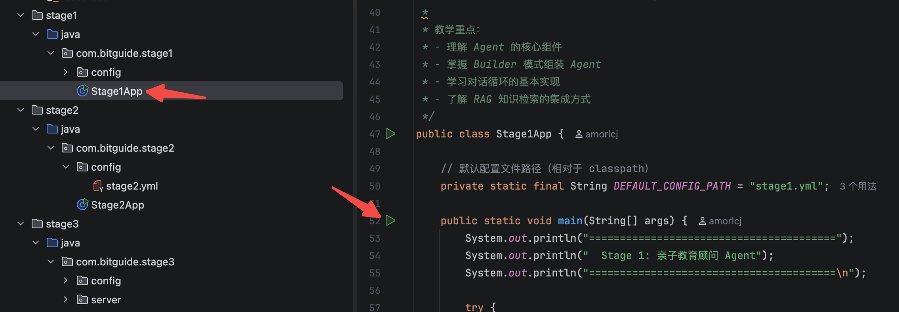
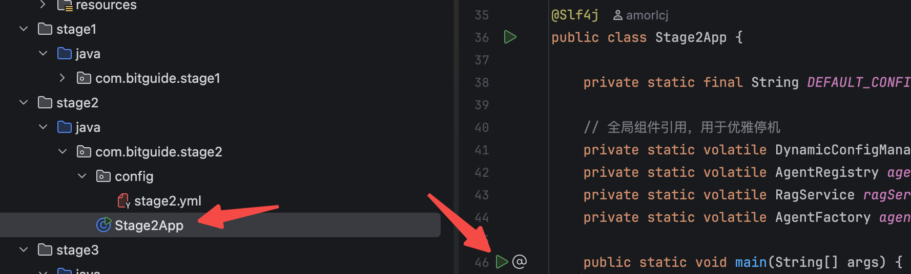
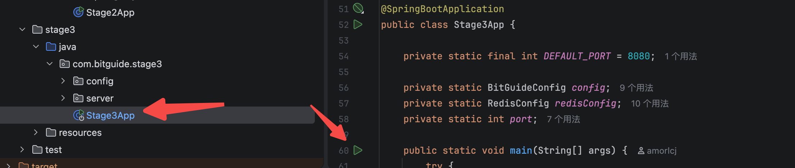
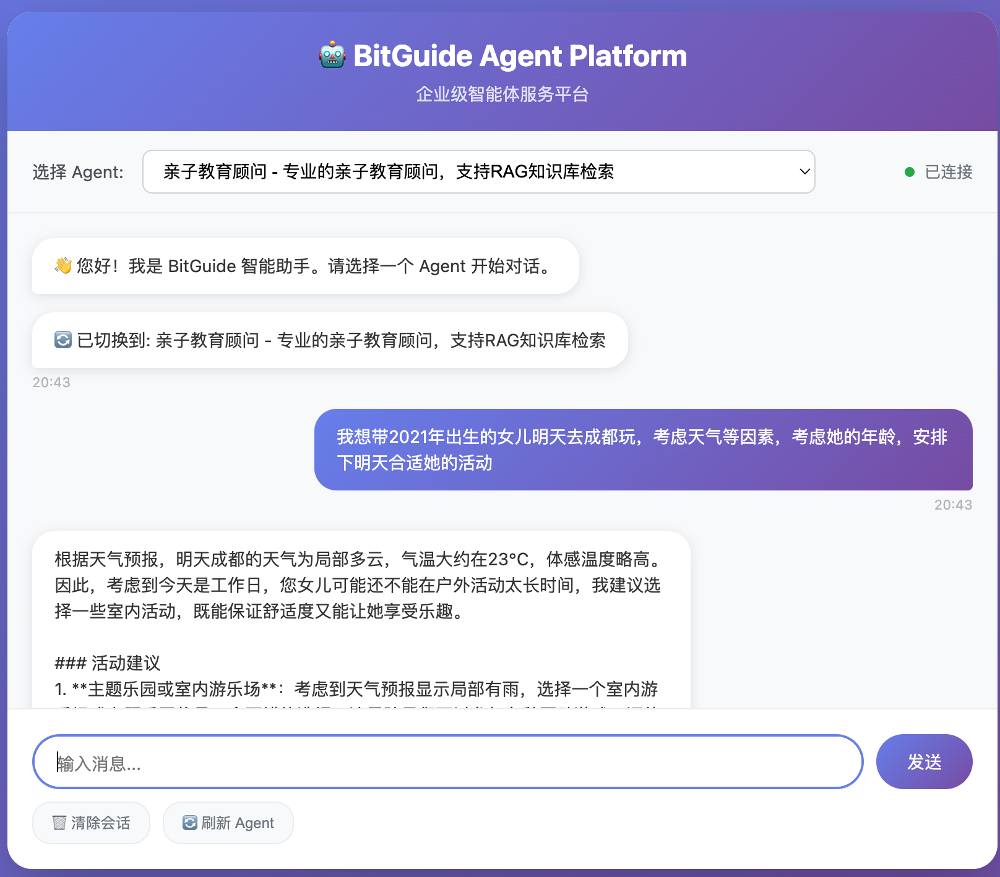
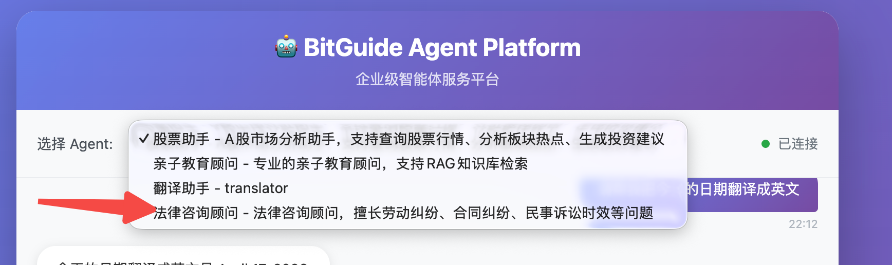

# 第7章 Java 实战 —— 从零跑通 BitGuide Agent Platform

前面三章讲了设计，这一章我们动手把 Java 版本跑起来。三个目标：**先跑起来看效果**、**理解代码怎么实现的**、**动手做练习**。

---

> **注意⚠️先代码下载**：[Java（选最新版本）](https://ecnz1eq1tqym.feishu.cn/wiki/FvoiwuGV6i79b2ke78JclJnqnBf)

## 第一部分：跑起来看效果

### 7.1 环境搭建

#### Windows WSL2 运行说明

本文采用 Windows Docker Desktop + WSL2 Ubuntu：Java、Maven、Ollama 均在 Ubuntu 中运行。除 PowerShell 代码块外，命令全部在 WSL Bash 执行。

首次安装，在 Windows 管理员 PowerShell 执行：

```powershell
wsl --install -d Ubuntu
# 按提示重启并打开 Ubuntu 创建用户；已安装者跳过安装
wsl --update
wsl -l -v
# 仅当 Ubuntu 的 VERSION 为 1 时执行
wsl --set-version Ubuntu 2
wsl -d Ubuntu
```

每个新 WSL 终端先执行（F: 盘映射为 /mnt/f）：

```bash
cd "/mnt/f/Agent项目/AiAgentForge/bitguide-agent-platform-main"
export JAVA_TOOL_OPTIONS="-Dfile.encoding=UTF-8"
```

后续相对路径均以此项目根目录为基准。文档本身位于项目上一级。IDEA 运行 Stage1App、Stage2App 或 Stage3App 时，请使用 WSL JDK，并设置项目根目录为工作目录，避免 Windows Java 与 WSL 服务混用。

官方参考：[WSL 安装](https://learn.microsoft.com/windows/wsl/install/)、[Docker WSL 集成](https://docs.docker.com/desktop/features/wsl/)、[Ollama Linux 安装](https://ollama.com/download/linux)。

#### 系统要求

| 项目 | 最低要求 | 说明 |
| --- | --- | --- |
| 内存 | 8 GB | Ollama 7B 模型需要约 5 GB |
| 磁盘 | 10 GB 可用 | Docker 镜像 + Ollama 模型 |
| 操作系统 | Windows + WSL2 Ubuntu | Windows 需要 WSL2 |

> **关于 LLM**：开发环境使用 Ollama 运行本地开源模型（qwen2.5），零成本调试。生产环境切换为 GPT-4o / 通义千问等商业 API，只需修改配置文件中的 `baseUrl` 和 `apiKey`，代码不需要任何改动。

#### 安装顺序（5 步）

##### 第一步：安装 JDK 17+

```Bash
# WSL Ubuntu
sudo apt update
sudo apt install -y openjdk-17-jdk curl ca-certificates netcat-openbsd

# 验证
java -version
# 输出应包含 "17" 或更高版本号
```

##### 第二步：安装 Maven

```Bash
# WSL Ubuntu
sudo apt install -y maven

# 验证
mvn -version
```

##### 第三步：安装 Ollama + 下载模型

```Bash
# 安装 Ollama
curl -fsSL https://ollama.com/install.sh | sh

# 先用 curl http://localhost:11434/api/tags 检查，已响应则跳过 serve。
# 未启动时在独立 WSL 终端执行并保持运行
ollama serve

# 另开一个终端，下载模型
ollama pull qwen2.5            # 对话模型，约 4.7 GB
ollama pull nomic-embed-text   # Embedding 模型（RAG 用），约 274 MB

# 验证
ollama list
# 应该看到 qwen2.5 和 nomic-embed-text
```

> **下载慢？** Ollama 模型托管在海外服务器，如果下载慢，可以设置代理：`export HTTPS_PROXY=your_proxy` 然后重试。

##### 第四步：安装 Docker Desktop（全部 Stage 需要）

Stage 1 的 RAG 功能依赖 Milvus 向量库（通过 Docker 运行），所以 Docker 是必须的。

在 Windows 安装并启动 [Docker Desktop](https://docs.docker.com/desktop/setup/install/windows-install/)。Settings → General 启用 Use the WSL 2 based engine；Settings → Resources → WSL Integration 启用 Ubuntu 并应用。使用 Linux containers 模式。无需在 Ubuntu 再安装 Docker Engine。

在 WSL 验证：

```bash
docker info
docker compose -f "/mnt/f/Agent项目/AiAgentForge/bitguide-agent-platform-main/docker/docker-compose-java-20261027.yml" version
```

##### 第五步：启动基础设施

 Java项目自带了独立的 `docker/docker-compose-java-20261027.yml`。

```Bash
cd docker

# 启动所有服务（Milvus + etcd + Redis）
docker compose -f "/mnt/f/Agent项目/AiAgentForge/bitguide-agent-platform-main/docker/docker-compose-java-20261027.yml" up -d

# 等约 30 秒让服务启动完成，然后检查状态
docker compose -f "/mnt/f/Agent项目/AiAgentForge/bitguide-agent-platform-main/docker/docker-compose-java-20261027.yml" ps

# 所有服务应 running；配置了健康检查的服务还应 healthy。Milvus 首次启动可能超过 90 秒。
```

> **Stage 1 最少需要**：`docker compose -f "/mnt/f/Agent项目/AiAgentForge/bitguide-agent-platform-main/docker/docker-compose-java-20261027.yml" up -d`（此版本 Milvus 依赖 milvus-etcd，使用本地存储，不包含 MinIO）

> **WSL 注意事项**：脚本若提示 `bash\r` 或 CRLF 错误，在项目根目录执行 `sed -i 's/\r$//' scripts/check-env.sh` 后重试。Ollama 与 Java 均在同一 WSL 内运行时才可直接使用本文 localhost 地址。
>
> **etcd**：下文通过配置中心容器中的 etcdctl 执行，无需在 WSL 单独安装。保留 `docker exec -i`，才能从本机 JSON 文件重定向输入；不要操作 Milvus 内部的 etcd。
>
> **构建差异**：当前 pom.xml 未定义教程中的 bitguide-stage1.jar、bitguide-stage3.jar，且声明的 com.bitguide.BitGuideApplication 未在预期路径找到。后续这些 jar 命令属于原教程示例，不能直接当作当前项目可运行命令。请构建后在 IDEA 使用 WSL JDK 运行对应 Stage 的 main 方法。

#### 一键环境检查

项目提供了环境检查脚本，可以一键检验所有依赖是否就位：

```Bash
# Stage 1 检查（RAG 实际运行还需要检查 Milvus 容器健康状态）
bash ./scripts/check-env.sh --stage 1

# Stage 2 检查（加上 Docker + etcd）
bash ./scripts/check-env.sh --stage 2

# 全量检查（加上 Redis + Milvus）
bash ./scripts/check-env.sh --stage 3

# 检查不通过时输出修复命令
bash ./scripts/check-env.sh --stage 1 --fix
```

所有项显示 `[✓]` 即可开始运行。

#### 端口总览

| 端口 | 服务 | 谁需要 | 启动方式 |
| --- | --- | --- | --- |
| 11434 | Ollama | 全部 Stage | `ollama serve` |
| 2379 | etcd | Stage 2+ | `docker compose -f "/mnt/f/Agent项目/AiAgentForge/bitguide-agent-platform-main/docker/docker-compose-java-20261027.yml" up -d bitguide-etcd` |
| 6379 | Redis | Stage 3 | `docker compose -f "/mnt/f/Agent项目/AiAgentForge/bitguide-agent-platform-main/docker/docker-compose-java-20261027.yml" up -d redis` |
| 19530 | Milvus | Stage 1+ RAG | `docker compose -f "/mnt/f/Agent项目/AiAgentForge/bitguide-agent-platform-main/docker/docker-compose-java-20261027.yml" up -d` |
| 8080 | 应用 HTTP | Stage 3 | 应用自动监听 |

#### 下载项目并构建

[AIAgentForge代码下载](https://ecnz1eq1tqym.feishu.cn/wiki/ElfDwHiXhiPD06kIqzdcmz5Mnjz)

```Bash
cd "/mnt/f/Agent项目/AiAgentForge/bitguide-agent-platform-main"

mvn clean package -DskipTests
```

### 7.2 运行三个阶段并验证

项目包含三个阶段，每个阶段都是前一个的增强。建议按顺序运行，感受演进过程。

#### Stage 1：单 Agent CLI

> **前置条件**：Ollama 运行中 + qwen2.5 模型已下载 + Milvus 容器运行中。不确定？运行 `bash ./scripts/check-env.sh --stage 1`。

直接IDEA编辑器中，找到Stage1的入口main; 点击运行!



正常启动后，你会看到：

```Plaintext
[BitGuide] 正在启动 Stage 1...
[BitGuide] Ollama 连接成功: http://localhost:11434
[BitGuide] 加载知识库: knowledge/parenting_docs/ (4 个文档, 23 个分块)
[BitGuide] 注册内置工具: calculator, datetime
[BitGuide] 连接 MCP Server: parenting-mcp-server
[BitGuide] 加载技能: parenting-activity-advice
[BitGuide] Agent 已就绪！
```

试试以下对话验证各能力：

```Plaintext
> 你好                           ← 基本对话能力
> 25 乘以 37 等于多少            ← 内置工具调用（calculator）
> 现在几点了                     ← 内置工具调用（datetime）
> 孩子情绪不好怎么办？             ← 知识库调用回答（RAG）
> 我想带2021年出生的女儿明天去成都玩，考虑天气等因素，考虑她的年龄，安排下明天合适她的活动          ← RAG 检索 + Skill 匹配 + MCP 工具调用
```

> "推荐户外活动"这个问题会触发完整的 Agent 能力链：Skill 匹配 → 注入专业 Prompt → RAG 检索知识 → ReACT 循环中调用天气和年龄计算等 MCP 工具 → 综合生成回答。

#### Stage 2：多 Agent CLI + etcd 热更新

> **前置条件**：Stage 1 全部就绪 + etcd 容器运行中（`docker compose -f "/mnt/f/Agent项目/AiAgentForge/bitguide-agent-platform-main/docker/docker-compose-java-20261027.yml" up -d bitguide-etcd`）。不确定？运行 `bash ./scripts/check-env.sh --stage 2`。

直接IDEA编辑器中，找到Stage2的入口main; 点击运行!



Stage 2 的 Agent 来自 **etcd 动态配置**，不是 YAML 静态定义。首次启动时 etcd 是空的，所以 Agent 列表为空：

```Plaintext
可用的 Agent (从 etcd 动态加载):
    ! 暂无可用 Agent，请通过 etcd 添加 Agent 配置

========================================
  开始对话
========================================
命令:
  /list       - 列出所有 Agent
  /switch id  - 切换 Agent
  /clear      - 清除对话历史
  /quit       - 退出
========================================
```

##### 推送 Agent 配置（另开一个终端）

项目在 `config/etcd-examples/` 目录下提供了预定义的 Agent JSON 配置，用 `etcdctl` 直接推送：

```Bash
# 推送亲子教育顾问
docker exec -i bitguide-config-etcd etcdctl --endpoints=http://127.0.0.1:2379 put /bitguide/config/agents/parenting_advisor < config/etcd-examples/agent-parenting_advisor.json

# 推送股票助手
docker exec -i bitguide-config-etcd etcdctl --endpoints=http://127.0.0.1:2379 put /bitguide/config/agents/stock_assistant < config/etcd-examples/agent-stock_assistant.json
```

推送后回到 Stage 2 CLI，执行 `/list` 可以看到新增的 Agent：

```Plaintext
> /list

可用的 Agent:
  - parenting_advisor: 专业的亲子教育顾问，支持RAG知识库检索
  - stock_assistant: A股市场分析助手

> /switch stock_assistant
  -已切换到 Agent: stock_assistant
 
你 [stock_assistant]> 帮我分析今天A股整体行情，并帮我分析600519这支个股
```

> **热更新体验**：整个过程 Stage 2 不需要重启。etcd 配置变更后，平台通过 Watch 机制实时感知并自动创建 Agent。

##### 动态新增自定义 Agent（验证热更新）

试试动态新增一个翻译助手，无需重启：

```Bash
docker exec -i bitguide-config-etcd etcdctl --endpoints=http://127.0.0.1:2379 put /bitguide/config/agents/translator '{"id":"translator","name":"翻译助手","modelRef":"ollama","systemPrompt":"你是专业的中英翻译助手。用户说中文你翻译成英文，说英文你翻译成中文。","toolRefs":["datetime"],"memory":{"enabled":true}}'
```

回到 CLI 执行 `/list`，可以看到新增的翻译助手。用 `/switch translator` 切换过去试试。

```Plaintext
> /switch translator
你 [translator]> 把今天的时间和月份翻译成英文
```

##### 常用 docker exec -i bitguide-config-etcd etcdctl --endpoints=http://127.0.0.1:2379 命令速查

```Bash
docker exec -i bitguide-config-etcd etcdctl --endpoints=http://127.0.0.1:2379 get /bitguide/config/agents/ --prefix --keys-only        # 列出所有 Agent
docker exec -i bitguide-config-etcd etcdctl --endpoints=http://127.0.0.1:2379 get /bitguide/config/agents/parenting_advisor --print-value-only  # 查看配置内容
docker exec -i bitguide-config-etcd etcdctl --endpoints=http://127.0.0.1:2379 del /bitguide/config/agents/translator                    # 删除指定 Agent
docker exec -i bitguide-config-etcd etcdctl --endpoints=http://127.0.0.1:2379 watch /bitguide/config/ --prefix                          # 实时监听配置变更
docker exec -i bitguide-config-etcd etcdctl --endpoints=http://127.0.0.1:2379 del /bitguide/config/ --prefix                            # 清空所有配置（慎用）
```

#### Stage 3：HTTP 服务 + Gateway

> **前置条件**：Stage 2 全部就绪 + 全部 Docker 服务启动（`docker compose -f "/mnt/f/Agent项目/AiAgentForge/bitguide-agent-platform-main/docker/docker-compose-java-20261027.yml" up -d`，确认 etcd + Redis + Milvus 全部 running）。不确定？运行 `bash ./scripts/check-env.sh --stage 3`。在 IDEA 中运行 Stage3App.main()，使用 WSL JDK。



```Plaintext
[BitGuide] HTTP 服务启动: http://localhost:8080
[BitGuide] Gateway 已就绪（Auth + Security + RateLimit）
```

可以在浏览器打开 `http://localhost:8080` 使用 Web 聊天界面。



#### 常见问题

| 问题 | 原因 | 解决 |
| --- | --- | --- |
| `Connection refused: localhost:11434` | Ollama 未启动 | 新终端执行 `ollama serve` |
| `model 'qwen2.5' not found` | 模型未拉取 | 执行 `ollama pull qwen2.5` |
| 中文乱码 | 终端编码问题 | 设置 `JAVA_TOOL_OPTIONS=-Dfile.encoding=UTF-8` |
| `etcd connection refused`（Stage 2/3） | etcd 未启动 | `docker compose -f "/mnt/f/Agent项目/AiAgentForge/bitguide-agent-platform-main/docker/docker-compose-java-20261027.yml" up -d bitguide-etcd` |
| `Redis connection refused`（Stage 3） | Redis 未启动 | `docker compose -f "/mnt/f/Agent项目/AiAgentForge/bitguide-agent-platform-main/docker/docker-compose-java-20261027.yml" up -d redis` |
| Docker 命令报错 `Cannot connect to daemon` | Docker Desktop 未启动 | 在 Windows 启动 Docker Desktop，确认 Ubuntu WSL Integration 已开启 |
| `port 2379 already in use` | 端口被其他程序占用 | 检查是否有其他 etcd 实例：`lsof -i :2379`，或停掉旧容器：`docker compose -f "/mnt/f/Agent项目/AiAgentForge/bitguide-agent-platform-main/docker/docker-compose-java-20261027.yml" down` |
| Ollama 模型下载失败/超慢 | 网络问题 | 设置代理 `export HTTPS_PROXY=your_proxy`，或从 https://ollama.ai/library/qwen2.5 手动下载 |
| Milvus 启动后端口不通 | Milvus 启动较慢 | 等 30-60 秒后执行 `nc -z localhost 19530 && echo OK` 验证 |
| 内存不足，电脑卡顿 | Ollama 7B 模型占内存 | 关闭其他占用内存的程序，或使用 `ollama pull qwen2.5:1.5b`（更小模型） |

> **一键诊断**：遇到环境问题时，运行 `bash ./scripts/check-env.sh --fix`，脚本会告诉你具体哪里有问题以及怎么修。

---

## 第二部分：代码结构与关键实现

### 7.3 项目结构

#### 目录总览

```Plaintext
bitguide-agent-platform-java/
├── src/main/java/com/bitguide/
│   ├── agent/          ← Agent 核心（BaseAgent, AgentFactory, AgentRegistry）
│   ├── llm/            ← LLM 客户端（OpenAI 兼容协议，多模型网关）
│   ├── rag/            ← RAG 检索增强（文档切分 + Embedding + 向量存储）
│   ├── tool/           ← 内置工具 + ToolManager
│   ├── skill/          ← Skill 技能系统（加载 + 匹配 + 增强 + 热更新）
│   ├── mcp/            ← MCP Client（stdio + HTTP 传输）
│   ├── memory/         ← 会话记忆（内存 + Redis 分布式）
│   ├── gateway/        ← 网关（Filter Chain + Lane + 限流）
│   ├── config/         ← 配置类（BitGuideConfig）
│   └── dynamic/        ← etcd 动态配置管理（观察者模式）
├── src/stage1/java/    ← Stage 1 入口 + 配置
├── src/stage2/java/    ← Stage 2 入口 + 配置
├── src/stage3/java/    ← Stage 3 入口 + 配置
├── src/main/resources/
│   ├── knowledge/      ← RAG 知识库文档（.md 文件）
│   └── skills/         ← Skill 定义（SKILL.md 文件）
├── mcp-servers/        ← MCP Server 进程
├── web/                ← Web 前端（index.html）
└── pom.xml
```

#### 各阶段入口

| 阶段 | 入口类 | 特点 |
| --- | --- | --- |
| Stage 1 | `Stage1App.main()` | 单 Agent CLI，硬编码组装 |
| Stage 2 | `Stage2App.main()` | 多 Agent CLI，配置驱动 + etcd |
| Stage 3 | `Stage3App.main()` | HTTP 服务 + Gateway + Web 前端 |

#### Maven 依赖演进

| 阶段 | 核心依赖 | 说明 |
| --- | --- | --- |
| Stage 1 | `openai-java`, `jackson` | LLM 调用 + JSON 解析 |
| Stage 2 | + `jetcd` | etcd 动态配置 |
| Stage 3 | + `spring-boot-starter-web`, `jedis` | HTTP 服务 + Redis |

### 7.4 Stage 1 代码走读

Stage 1 的目标：**用 ~500 行代码证明 Agent 核心闭环能跑通**。

#### 7.4.1 启动流程

`Stage1App.main()` 做了 7 件事，按顺序组装：

```Plaintext
Stage1App.main()
    │
    ├── 1. 加载配置（stage1.yml）
    │      └── LLM 地址、模型名称、知识库路径...
    ├── 2. 创建 LLM 客户端
    │      └── OpenAI 兼容客户端 → 连接 Ollama
    ├── 3. 构建 RAG 索引
    │      ├── 读取 knowledge/ 下的 .md 文件
    │      ├── 切分（500 字符/块，100 字符重叠）
    │      ├── Embedding → nomic-embed-text
    │      └── 存入 MemoryVectorStore
    ├── 4. 注册工具
    │      ├── 内置: Calculator, DateTime
    │      └── MCP: mcp-server → 业务工具
    ├── 5. 加载 Skill
    │      └── skills/ 目录下的 SKILL.md 文件
    ├── 6. 组装 Agent
    │      └── BaseAgent.builder()(...)...build()
    └── 7. 进入 CLI 交互循环
           └── 读取用户输入 → agent.execute() → 打印响应
```

#### 7.4.2 Agent.execute() —— 核心循环

这是整个项目的"心脏"，三个阶段共用同一个方法：

```Java
public String execute(String userInput, String sessionId) {
    // 1. 记录用户消息
    memory.recordUserMessage(sessionId, userInput);

    // 2. Skill 匹配（如果匹配到，覆盖 systemPrompt）
    String systemPrompt = this.systemPrompt;
    Skill matched = skillManager.match(userInput);
    if (matched != null) {
        systemPrompt = matched.getSystemPrompt();
    }

    // 3. RAG 检索相关上下文
    List<String> contexts = ragService.search(userInput, topK);

    // 4. 构建消息列表
    List<Message> messages = buildMessages(systemPrompt, contexts, sessionId);

    // 5. ReACT 循环（最多 10 次）
    for (int i = 0; i < maxIterations; i++) {
        LLMResponse response = llm.chat(messages);

        if (!response.hasToolCalls()) {
            // LLM 直接回复，记录并返回
            memory.recordAssistantResponse(sessionId, response.getContent());
            return response.getContent();
        }

        // 有工具调用 → 执行 → 结果追加到消息列表 → 继续循环
        for (ToolCall call : response.getToolCalls()) {
            String result = toolManager.execute(call.getName(), call.getArguments());
            messages.add(new ToolResultMessage(call.getId(), result));
        }
    }
    return "抱歉，处理轮次已达上限。";
}
```

**对应设计文档**：这段代码就是第 4 章 §4.3 中 ReACT 循环伪代码的 Java 实现。可以对照着看——伪代码中的每一个步骤在这里都有对应的 Java 代码。

**关键设计点**：

| 设计点 | 说明 | 对应设计文档 |
| --- | --- | --- |
| Skill 匹配在 LLM 调用前 | 先判断用户意图，再决定用哪个专业 Prompt | §4.6 Skill 增强机制 |
| RAG 检索在 LLM 调用前 | 先找知识，再把知识注入到 Prompt 中 | §4.4 RAG 管道 |
| maxIterations 安全阀 | 防止 LLM 无限循环调用工具 | §4.3 ReACT 循环上限 |
| ToolResult 追加到消息 | LLM 看到工具结果后，再决定是继续调用还是直接回复 | §4.5 Tool 与 MCP |
| 异常不阻断循环 | 工具执行失败时返回错误信息给 LLM，LLM 可以调整策略 | §4.7 错误处理 |

#### 7.4.3 RAG 服务

```Plaintext
buildIndex():
  .md 文件 → 按 500 字符切分（100 重叠）→ Embedding → 存入向量库

search(query, topK):
  query → Embedding → 向量相似度搜索 → 返回 Top-K 文档片段
```

Stage 1 使用 `MilvusVectorStore`（通过 Docker 运行的 Milvus），配置在 `stage1.yml` 的 `rag.vectorStore.type: milvus`。

### 7.5 Stage 2-3 代码走读

Stage 2 和 Stage 3 **不改动** Stage 1 的任何核心组件，只是在外围叠加新能力。

#### 7.5.1 Stage 2：工厂 + 注册表 + etcd

**新增的核心类**：

| 类 | 包 | 职责 | 对应设计文档 |
| --- | --- | --- | --- |
| `AgentFactory` | `agent/` | 根据配置创建 Agent | §5.2 工厂模式 |
| `AgentRegistry` | `agent/` | Agent 注册/查询/更新/注销 | §5.2 注册表模式 |
| `AgentEntry` | `agent/` | 引用计数 + Agent 元数据 | §5.2 引用计数保护 |
| `DynamicConfigManager` | `dynamic/` | etcd Watch 事件分发 | §5.4 热更新 |
| `EtcdConfigWatcher` | `dynamic/` | 监听 etcd 变更 | §5.4 观察者模式 |

**工厂创建 Agent 的关键代码**：

```Java
public Agent create(AgentConfig config) {
    ChatLanguageModel llm = llmGateway.getOrCreateModel(config.getModelRef());
    ToolManager toolManager = loadTools(config.getToolRefs(), config.getMcpServers());
    RagService rag = config.getKnowledgeBase() != null
        ? ragService : null;

    return BaseAgent.builder()
        .id(config.getId())
        .name(config.getName())
        .model(llm)
        .systemPrompt(config.getSystemPrompt())
        .toolManager(toolManager)
        .ragService(rag)
        .memory(new ConversationMemory())
        .skillManager(skillManager)
        .build();
}
```

**etcd 热更新处理**：

```Java
// DynamicConfigManager 事件分发（简化）
void handleEvent(ConfigEvent event) {
    switch (event.getConfigType()) {
        case "agents":
            if (event.isPut()) {
                Agent agent = factory.create(parseConfig(event.getValue()));
                registry.register(event.getConfigId(), agent);
            } else if (event.isDelete()) {
                registry.unregister(event.getConfigId());
            }
            break;
        case "skills":
            if (event.isPut()) skillManager.register(parseSkill(event.getValue()));
            else skillManager.unregister(event.getConfigId());
            break;
        case "knowledgebases":
            if (event.isPut()) ragService.initKnowledgeBase(parseKB(event.getValue()));
            else ragService.deleteKnowledgeBase(event.getConfigId());
            break;
    }
}
```

**CLI 交互升级**：

```Plaintext
[BitGuide] 已加载 2 个 Agent:
  1. parenting_advisor - 亲子教育顾问
  2. stock_assistant - 股票助手

> /list                    ← 列出所有 Agent
> /switch stock_assistant  ← 切换到另一个 Agent
> /clear                   ← 清空当前会话
```

#### 7.5.2 Stage 3：Gateway + HTTP + Web

**新增的核心类**：

| 类 | 包 | 职责 | 对应设计文档 |
| --- | --- | --- | --- |
| `AgentGateway` | `gateway/` | 网关入口，编排 Filter Chain | §6.2 Gateway 设计 |
| `AuthFilter` | `gateway/` | API Key 认证 | §6.4 认证 |
| `SecurityFilter` | `gateway/` | 注入检测 + 敏感词 + 长度限制 | §6.5 安全防护 |
| `RateLimitFilter` | `gateway/` | 令牌桶限流 | §6.6 限流 |
| `LaneManager` | `gateway/` | 会话串行化 | §6.7 Lane |
| `DistributedMemory` | `memory/` | Redis 分布式会话 | §6.8 分布式 |
| `DistributedAgentGateway` | `gateway/` | 分布式网关（Redis 版） | §6.8 分布式 |

**Filter Chain 的实现**：

```Java
// 所有 Filter 实现同一个接口
public interface GatewayFilter {
    GatewayResponse doFilter(RequestContext ctx, FilterChain chain);
}

// 责任链执行逻辑
for (GatewayFilter filter : filters) {
    GatewayResponse response = filter.doFilter(ctx, chain);
    if (response != null) return response;  // 被拦截
}
// 全部通过 → 执行 Agent
```

**AuthFilter 实现**：

```Java
public class AuthFilter implements GatewayFilter {
    private final Map<String, String> apiKeys;  // token → userId

    public GatewayResponse doFilter(RequestContext ctx, FilterChain chain) {
        String apiKey = ctx.getHeader("X-API-Key");
        if (apiKey == null || !apiKeys.containsKey(apiKey)) {
            return ErrorResponse(401, "UNAUTHORIZED", "无效的 API Key");
        }
        ctx.setUserId(apiKeys.get(apiKey));
        return null;  // 通过
    }
}
```

**HTTP API 端点**：

| 端点 | 方法 | 说明 |
| --- | --- | --- |
| `/api/v1/chat` | POST | 对话（传入 message, agentId, sessionId） |
| `/api/v1/agents` | GET | 列出所有可用 Agent |
| `/api/v1/agents/{id}` | GET | 获取指定 Agent 信息 |
| `/api/v1/sessions/{id}` | DELETE | 清空会话 |
| `/health` | GET | 健康检查 |

**Web 前端**：Stage 3 附带一个 `web/index.html`，提供聊天界面，通过 AJAX 调用上述 API。

#### 7.5.3 三阶段代码量对比

| 阶段 | 核心代码 | 新增内容 |
| --- | --- | --- |
| Stage 1 | ~500 行 | Agent + LLM + RAG + Tool + Skill + Memory |
| Stage 2 | +~500 行 | Factory + Registry + etcd + 多 Agent CLI + 多模型网关 |
| Stage 3 | +~1000 行 | Gateway + Filter Chain + Lane + 分布式 + HTTP + Web |

---

## 第三部分：动手练习

## 动手练习 —— 搭建一个法律咨询 Agent

这四个练习带你从零搭建一个**法律咨询顾问** Agent。每个练习都是前一个的基础，完成后你将拥有一个完整的、可通过 etcd 动态部署的法律咨询 Agent。

---

### 练习 1：创建法律工具 MCP Server（入门）

**目标**：创建一个 `legal-mcp-server`，提供 `statute_of_limitations` 工具，根据案件类型和发生日期计算诉讼时效。

> **设计原则**：业务场景的工具应该通过 MCP Server 提供，而不是内置到平台代码中。内置工具（calculator、datetime）是平台通用工具；业务工具（诉讼时效计算）是特定场景的工具。使用 MCP Server 可以在不修改平台代码的情况下扩展工具能力。这与项目中 `parenting-mcp-server` 和 `stock-mcp-server` 的方式完全一致。

**第一步**：创建目录并创建 MCP Server 文件

```Bash
mkdir -p extensions/legal/mcp-server
```

创建 `extensions/legal/mcp-server/LegalMcpServer.java`：

> 参考现有的 `ParentingMcpServer.java` 和 `StockMcpServer.java`，MCP Server 是一个零依赖的单文件 Java 程序，通过 stdio 读取 JSON-RPC 请求、返回结果。

```Java
import java.io.*;
import java.nio.charset.StandardCharsets;
import java.time.LocalDate;
import java.time.temporal.ChronoUnit;
import java.util.*;

public class LegalMcpServer {

    private static final String SERVER_NAME = "legal-tools";
    private static final String SERVER_VERSION = "1.0.0";
    private static final String PROTOCOL_VERSION = "2024-11-05";

    private static BufferedReader reader;
    private static BufferedWriter writer;

    private static final Map<String, Integer> PERIODS = Map.of(
        "合同纠纷", 3, "劳动争议", 1, "人身损害", 1,
        "知识产权", 3, "房屋租赁", 1
    );

    public static void main(String[] args) {
        reader = new BufferedReader(new InputStreamReader(System.in, StandardCharsets.UTF_8));
        writer = new BufferedWriter(new OutputStreamWriter(System.out, StandardCharsets.UTF_8));
        logError("Legal Tools MCP Server 启动");
        try {
            String line;
            while ((line = reader.readLine()) != null) {
                processRequest(line);
            }
        } catch (Exception e) {
            logError("Server 错误: " + e.getMessage());
        }
    }

    private static void processRequest(String json) {
        try {
            Map<String, Object> request = parseJson(json);
            String method = (String) request.get("method");
            Object id = request.get("id");
            @SuppressWarnings("unchecked")
            Map<String, Object> params = (Map<String, Object>) request.get("params");
            Object result = null;
            Map<String, Object> error = null;
            try {
                switch (method) {
                    case "initialize": result = handleInitialize(); break;
                    case "notifications/initialized": return;
                    case "tools/list": result = handleToolsList(); break;
                    case "tools/call": result = handleToolsCall(params); break;
                    default: error = createError(-32601, "方法不存在: " + method);
                }
            } catch (Exception e) {
                error = createError(-32000, "执行错误: " + e.getMessage());
            }
            if (id != null) sendResponse(id, result, error);
        } catch (Exception e) {
            logError("解析请求失败: " + e.getMessage());
        }
    }

    private static Map<String, Object> handleInitialize() {
        Map<String, Object> result = new LinkedHashMap<>();
        result.put("protocolVersion", PROTOCOL_VERSION);
        Map<String, Object> serverInfo = new LinkedHashMap<>();
        serverInfo.put("name", SERVER_NAME);
        serverInfo.put("version", SERVER_VERSION);
        result.put("serverInfo", serverInfo);
        Map<String, Object> capabilities = new LinkedHashMap<>();
        capabilities.put("tools", Collections.singletonMap("listChanged", false));
        result.put("capabilities", capabilities);
        return result;
    }

    private static Map<String, Object> handleToolsList() {
        Map<String, Object> result = new LinkedHashMap<>();
        List<Map<String, Object>> tools = new ArrayList<>();

        // statute_of_limitations 工具
        Map<String, Object> schema = new LinkedHashMap<>();
        schema.put("type", "object");
        Map<String, Object> props = new LinkedHashMap<>();
        Map<String, Object> caseTypeProp = new LinkedHashMap<>();
        caseTypeProp.put("type", "string");
        caseTypeProp.put("description", "案件类型：合同纠纷/劳动争议/人身损害/知识产权/房屋租赁");
        props.put("caseType", caseTypeProp);
        Map<String, Object> dateProp = new LinkedHashMap<>();
        dateProp.put("type", "string");
        dateProp.put("description", "事发日期，格式 YYYY-MM-DD，如 2024-06-15");
        props.put("incidentDate", dateProp);
        schema.put("properties", props);
        schema.put("required", List.of("caseType", "incidentDate"));
        tools.add(createToolDefinition("statute_of_limitations",
            "根据案件类型和发生日期计算诉讼时效。支持：合同纠纷(3年)、劳动争议(1年)、人身损害(1年)、知识产权(3年)、房屋租赁(1年)",
            schema));

        result.put("tools", tools);
        return result;
    }

    private static Map<String, Object> createToolDefinition(String name, String description, Map<String, Object> inputSchema) {
        Map<String, Object> tool = new LinkedHashMap<>();
        tool.put("name", name);
        tool.put("description", description);
        tool.put("inputSchema", inputSchema);
        return tool;
    }

    @SuppressWarnings("unchecked")
    private static Map<String, Object> handleToolsCall(Map<String, Object> params) throws Exception {
        String toolName = (String) params.get("name");
        Map<String, Object> arguments = (Map<String, Object>) params.get("arguments");
        if (arguments == null) arguments = Collections.emptyMap();
        String output;
        boolean isError = false;
        try {
            switch (toolName) {
                case "statute_of_limitations": output = doStatuteOfLimitations(arguments); break;
                default: output = "未知工具: " + toolName; isError = true;
            }
        } catch (Exception e) {
            output = "工具执行错误: " + e.getMessage();
            isError = true;
        }
        Map<String, Object> result = new LinkedHashMap<>();
        result.put("content", List.of(Map.of("type", "text", "text", output)));
        result.put("isError", isError);
        return result;
    }

    // ==================== statute_of_limitations 实现 ====================

    private static String doStatuteOfLimitations(Map<String, Object> args) {
        String caseType = (String) args.get("caseType");
        String dateStr = (String) args.get("incidentDate");

        Integer years = PERIODS.get(caseType);
        if (years == null) return "不支持的案件类型: " + caseType;

        LocalDate incidentDate = LocalDate.parse(dateStr);
        LocalDate deadline = incidentDate.plusYears(years);
        LocalDate today = LocalDate.now();

        long daysRemaining = ChronoUnit.DAYS.between(today, deadline);
        String status;
        if (daysRemaining < 0) {
            status = "已超过诉讼时效";
        } else if (daysRemaining < 90) {
            status = "⚠ 即将超过诉讼时效（剩余 " + daysRemaining + " 天）";
        } else {
            status = "仍在时效内（剩余 " + daysRemaining + " 天）";
        }

        return String.format("案件类型: %s\n诉讼时效: %d 年\n事发日期: %s\n截止日期: %s\n当前状态: %s",
            caseType, years, dateStr, deadline, status);
    }

    // ==================== JSON-RPC ====================

    private static void sendResponse(Object id, Object result, Map<String, Object> error) {
        Map<String, Object> r = new LinkedHashMap<>();
        r.put("jsonrpc", "2.0"); r.put("id", id);
        r.put(error != null ? "error" : "result", error != null ? error : result);
        try { writer.write(toJson(r)); writer.newLine(); writer.flush(); } catch (Exception e) { logError("发送失败: " + e.getMessage()); }
    }
    private static Map<String, Object> createError(int code, String msg) { Map<String, Object> e = new LinkedHashMap<>(); e.put("code", code); e.put("message", msg); return e; }

    // ==================== JSON 解析器 ====================
    private static Map<String, Object> parseJson(String json) { return new SJP(json).parseObject(); }
    private static String toJson(Object o) {
        if (o == null) return "null";
        if (o instanceof String) return "\"" + esc((String)o) + "\"";
        if (o instanceof Boolean) return o.toString();
        if (o instanceof Number) { Number n = (Number)o; if (n instanceof Double || n instanceof Float) { double d = n.doubleValue(); if (d == Math.floor(d) && !Double.isInfinite(d)) return String.valueOf((long)d); return n.toString(); } return String.valueOf(n.longValue()); }
        if (o instanceof Map) { StringBuilder s = new StringBuilder("{"); boolean f = true; for (Map.Entry<?,?> e : ((Map<?,?>)o).entrySet()) { if (!f) s.append(","); s.append("\"").append(e.getKey()).append("\":").append(toJson(e.getValue())); f = false; } return s.append("}").toString(); }
        if (o instanceof List) { StringBuilder s = new StringBuilder("["); boolean f = true; for (Object i : (List<?>)o) { if (!f) s.append(","); s.append(toJson(i)); f = false; } return s.append("]").toString(); }
        return "\"" + esc(o.toString()) + "\"";
    }
    private static String esc(String s) { return s.replace("\\","\\\\").replace("\"","\\\"").replace("\n","\\n").replace("\r","\\r").replace("\t","\\t"); }
    static class SJP {
        private final String j; private int p = 0;
        SJP(String j) { this.j = j.trim(); }
        Map<String,Object> parseObject() { Map<String,Object> m = new LinkedHashMap<>(); skip(); if (p>=j.length()||j.charAt(p)!='{') return m; p++; while(p<j.length()){skip();if(p>=j.length())break;if(j.charAt(p)=='}'){p++;break;}if(j.charAt(p)==','){p++;continue;}String k=parseString();skip();if(p<j.length()&&j.charAt(p)==':')p++;skip();m.put(k,parseValue());} return m; }
        Object parseValue() { skip(); if(p>=j.length())return null; char c=j.charAt(p); if(c=='"')return parseString(); if(c=='{')return parseObject(); if(c=='[')return parseArray(); if(c=='t'||c=='f')return parseBoolean(); if(c=='n'){p+=4;return null;} if(c=='-'||Character.isDigit(c))return parseNumber(); return null; }
        String parseString() { skip(); if(p>=j.length()||j.charAt(p)!='"')return ""; p++; StringBuilder s=new StringBuilder(); while(p<j.length()){char c=j.charAt(p++);if(c=='"')break;if(c=='\\'&&p<j.length()){char n=j.charAt(p++);if(n=='n')s.append('\n');else if(n=='t')s.append('\t');else if(n=='r')s.append('\r');else if(n=='u'&&p+3<j.length()){try{s.append((char)Integer.parseInt(j.substring(p,p+4),16));}catch(Exception e){}p+=4;}else s.append(n);}else s.append(c);} return s.toString(); }
        List<Object> parseArray() { List<Object> l=new ArrayList<>(); p++; while(p<j.length()){skip();if(p>=j.length())break;if(j.charAt(p)==']'){p++;break;}if(j.charAt(p)==','){p++;continue;}l.add(parseValue());} return l; }
        Number parseNumber() { int s=p; if(j.charAt(p)=='-')p++; while(p<j.length()&&"0123456789.eE+-".indexOf(j.charAt(p))>=0)p++; String ns=j.substring(s,p); try{return ns.contains(".")||ns.contains("e")||ns.contains("E")?Double.parseDouble(ns):Integer.parseInt(ns);}catch(Exception e){return 0;} }
        Boolean parseBoolean() { if(j.substring(p).startsWith("true")){p+=4;return true;} if(j.substring(p).startsWith("false")){p+=5;return false;} return false; }
        void skip() { while(p<j.length()&&Character.isWhitespace(j.charAt(p)))p++; }
    }

    private static void logError(String m) { System.err.println("[Legal-MCP-Server] " + m); }
}
```

**第二步**：在 Stage 1 的 `stage1.yml` 中配置 MCP Server

在 `mcp.servers` 列表中添加 `legal-tools`：

```YAML
# MCP 配置（用于接入外部工具）
mcp:
  enabled: true
  servers:
    - name: parenting-tools
      transport: stdio
      command: java
      args: ["mcp-servers/parenting-mcp-server/ParentingMcpServer.java"]
      timeout: 30000
    - name: legal-tools              # ← 新增
      transport: stdio
      command: java
      args: ["extensions/legal/mcp-server/LegalMcpServer.java"]
      timeout: 30000
```

> **注意**：MCP 配置是顶层 `mcp.servers` 列表，所有 MCP Server 在这里统一声明，不需要在 agent 里重复配置。

**第三步**：测试

```Bash
mvn clean package -DskipTests && java -jar target/bitguide-stage1.jar
```

```Plaintext
> 我和朋友在 2023 年 5 月签了一份借款合同，他至今没还，我还来得及起诉吗？
```

Agent 会通过 MCP 调用 `statute_of_limitations` 工具，计算合同纠纷的 3 年时效，告知你截止日期。

---

### 练习 2：添加法律知识文档（入门）

**目标**：创建法律知识库，为 Agent 提供专业的法律知识储备。

> **关键概念**：RAG 不是"把文件放到目录就生效"。Stage 1 的知识库加载逻辑是：读取 `agent.knowledgeBase` 配置值，如果包含 `/` 则直接作为路径，否则拼接 `knowledge/` 前缀。所以需要两步：① 创建文档文件到正确目录 ② 在 `stage1.yml` 中将 `agent.knowledgeBase` 指向新目录。

**第一步**：创建知识库目录和文档

```Bash
mkdir -p extensions/legal/knowledge
```

创建 `extensions/legal/knowledge/labor_law_faq.md`：

```Markdown
# 劳动法常见问题

## 加班工资怎么算？

根据《劳动法》第44条规定：
- 工作日加班：支付不低于工资的 150%
- 休息日加班（不能补休）：支付不低于工资的 200%
- 法定节假日加班：支付不低于工资的 300%

月计薪天数 = 21.75 天
日工资 = 月工资 ÷ 21.75

## 试用期最长多久？

根据《劳动合同法》第19条：
- 合同期限 3 个月到 1 年：试用期不超过 1 个月
- 合同期限 1 年到 3 年：试用期不超过 2 个月
- 合同期限 3 年以上或无固定期限：试用期不超过 6 个月
- 同一用人单位与同一劳动者只能约定一次试用期

## 被公司辞退能拿到多少补偿？

根据《劳动合同法》第47条：
- 经济补偿按劳动者在本单位工作的年限计算
- 每满一年支付一个月工资的标准
- 六个月以上不满一年的，按一年计算
- 不满六个月的，支付半个月工资
- 月工资是指劳动者在劳动合同解除前十二个月的平均工资

## 未签劳动合同有什么后果？

根据《劳动合同法》第82条：
- 用人单位自用工之日起超过一个月不满一年未与劳动者订立书面劳动合同的
- 应当向劳动者每月支付二倍的工资

## 社保是必须缴的吗？

根据《社会保险法》第58条：
- 用人单位应当自用工之日起三十日内为其职工向社会保险经办机构申请办理社会保险登记
- 未办理社会保险登记的，由社会保险经办机构核定其应当缴纳的社会保险费
- 公司不缴社保属于违法行为，员工可以要求补缴

## 什么情况可以申请劳动仲裁？

以下劳动争议可以申请劳动仲裁：
- 因确认劳动关系发生的争议
- 因订立、履行、变更、解除和终止劳动合同发生的争议
- 因除名、辞退和辞职、离职发生的争议
- 因工作时间、休息休假、社会保险、福利、培训以及劳动保护发生的争议
- 因劳动报酬、工伤医疗费、经济补偿或者赔偿金等发生的争议

劳动仲裁时效为一年，从当事人知道或者应当知道其权利被侵害之日起计算。
```

创建 `extensions/legal/knowledge/contract_law_basics.md`：

```Markdown
# 合同法基础知识

## 借款合同的诉讼时效是多久？

根据《民法典》第188条：
- 向人民法院请求保护民事权利的诉讼时效期间为三年
- 诉讼时效期间自权利人知道或者应当知道权利受到损害以及义务人之日起计算
- 超过诉讼时效，人民法院不予保护

## 定金和订金有什么区别？

- **定金**：具有法律约束力。给付定金一方不履行合同的，无权要求返还；收受定金一方不履行合同的，应当双倍返还。定金数额不得超过主合同标的额的 20%。
- **订金**：属于预付款性质，不具备定金的法律效力。合同未履行时，订金应当退还。

## 合同违约金怎么算？

根据《民法典》第585条：
- 当事人可以约定一方违约时应当根据违约情况向对方支付一定数额的违约金
- 约定的违约金低于造成的损失的，人民法院可以予以增加
- 约定的违约金过分高于造成的损失的，人民法院可以予以适当减少
- 一般认为违约金超过造成损失的 30% 就属于"过分高于"
```

**第二步**：修改 `stage1.yml`，将 `knowledgeBase` 指向法律知识库

编辑 `src/stage1/java/com/bitguide/stage1/config/stage1.yml`：

```YAML
agent:
  id: parenting_advisor
  name: 亲子教育顾问
  knowledgeBase: extensions/legal/knowledge  # ← 指向扩展目录（区别于内置的 parenting_docs）
  # ... 其他配置不变 ...
```

> **为什么需要这一步？** Stage 1 启动时会根据 `agent.knowledgeBase` 的值确定文档目录：如果值包含 `/`（如 `extensions/legal/knowledge`），直接使用该路径；否则拼接 `knowledge/` 前缀（如 `parenting_docs` → `knowledge/parenting_docs`）。

**第三步**：重启 Stage 1 测试

```Bash
mvn clean package -DskipTests && java -jar target/bitguide-stage1.jar
```

启动日志中会看到知识库加载信息。然后测试：

```Plaintext
> 公司没给我缴社保怎么办？
```

Agent 的回答会引用你写入的法律知识文档内容，说明 RAG 检索生效了。

### 练习 3：添加劳动纠纷咨询 Skill（中级）

**目标**：创建一个劳动纠纷咨询 Skill，当用户询问劳动争议相关问题时自动匹配专业 Prompt。

**第一步**：创建 Skill 目录

```Bash
mkdir -p extensions/legal/skills/labor-dispute
```

**第二步**：创建 `extensions/legal/skills/labor-dispute/SKILL.md`

```Markdown
---
name: 劳动纠纷咨询
description: 劳动争议、劳动合同、工资纠纷、社保、加班费、辞退补偿、工伤、试用期、劳动仲裁
tools:
  - statute_of_limitations
examples:
  - userInput: "公司把我辞退了能拿到多少补偿"
    response: "根据《劳动合同法》第47条，经济补偿按工作年限计算，每满一年支付一个月工资..."
  - userInput: "试用期被辞退有补偿吗"
    response: "试用期被辞退是否有补偿，取决于辞退理由是否合法..."
---

你是一位专业的劳动法律顾问，擅长处理各类劳动争议问题。

## 回答规范

1. **先明确法律依据**：引用具体的法律条文（如《劳动合同法》第XX条、《劳动法》第XX条）
2. **给出实用建议**：告诉用户下一步应该怎么做（保留证据、协商、仲裁）
3. **提醒时效**：涉及仲裁或诉讼的，提醒一年时效限制，必要时调用 statute_of_limitations 工具计算
4. **保持中立**：客观分析双方权利义务，不做价值判断

## 注意事项

- 涉及具体金额计算的，要给出计算公式和示例
- 不同地区的规定可能有差异，提醒用户咨询当地人社部门
- 提醒用户保留相关证据（工资条、考勤记录、聊天记录等）
```

**第三步**：修改 `stage1.yml` 中的 Skills 目录

将 Skills 目录指向扩展目录：

```YAML
skills:
  enabled: true
  directory: extensions/legal/skills
```

**第四步**：重启并测试

```Bash
mvn clean package -DskipTests && java -jar target/bitguide-stage1.jar
```

```Plaintext
> 公司拖欠了我三个月工资，还让我主动离职，我该怎么办？
```

Skill 被匹配后，Agent 会使用专业的劳动法律顾问 Prompt 回答。

> **再试一个会触发 MCP 工具的问题**：上面的补偿问题模型可以直接从知识库回答。试试时效相关的问题，模型会调用 `statute_of_limitations` 工具来精确计算：

```Plaintext
> 我的劳动合同是2024年3月签的，公司一直没给缴社保，现在还能申请劳动仲裁吗？
```

> Agent 会匹配劳动纠纷 Skill，并调用 MCP 工具计算劳动争议的 1 年仲裁时效。

> **对比**：Stage 1 通过 SKILL.md 文件加载（需重启），练习 4 中我们将看到 Stage 2 如何通过 etcd JSON 动态注册同一个 Skill（无需重启）。

---

### 练习 4：动态部署法律咨询 Agent（挑战）

**目标**：从零开始，在一个**已经运行的** Stage 3 服务上，不重启、不改代码，动态新增一个完整的法律咨询 Agent。

**核心体验**：这个练习模拟的是真实的运维场景——服务已经在跑，产品经理说要加一个"法律咨询"功能，你只需要准备资源、推送配置，新 Agent 立刻上线。

**前提条件**：

- Stage 3 已启动，当前只有育儿顾问 Agent（无法律相关的 RAG、MCP、Skill）

- etcd 和 Ollama 正在运行

- 练习 1 中创建的 `LegalMcpServer.java` 已存在于 `extensions/legal/mcp-server/` 目录

---

**第一步**：启动 Stage 3（此时只有育儿顾问）

```Bash
# 确保 etcd 正在运行
docker exec -i bitguide-config-etcd etcdctl --endpoints=http://127.0.0.1:2379 endpoint health

# 启动 Stage 3
mvn clean package -DskipTests && java -jar target/bitguide-stage3.jar
```

启动日志确认：当前没有法律相关的任何资源。

```Plaintext
> GET http://localhost:8080/api/v1/agents
{"agents": [{"id": "parenting_advisor", "name": "亲子教育顾问"}]}
```

---

**第二步**：准备知识库文档（文件系统操作，不需要重启服务）

```Bash
mkdir -p extensions/legal/knowledge
```

创建 `extensions/legal/knowledge/labor_law_faq.md`（内容同练习 2，此处省略）。
创建 `extensions/legal/knowledge/contract_law_basics.md`（内容同练习 2，此处省略）。

> 文档放到文件系统后，平台还不知道它们的存在。需要通过 etcd 推送知识库配置来触发加载。

---

**第三步**：推送知识库配置到 etcd（触发文档摄取）

```Bash
docker exec -i bitguide-config-etcd etcdctl --endpoints=http://127.0.0.1:2379 put /bitguide/config/knowledgebases/legal_docs '{
  "id": "legal_docs",
  "name": "法律知识库",
  "sources": [
    {
      "type": "file",
      "path": "extensions/legal/knowledge",
      "extensions": [".md"]
    }
  ]
}'
```

平台日志实时输出：

```Plaintext
[Dynamic] 收到配置变更事件: ConfigEvent{type=PUT, configType='knowledgebases', configId='legal_docs'}
[Dynamic] 知识库配置 [legal_docs] 已更新
[RAG] 开始加载知识库 [legal_docs] 的文档...
[RAG] 知识库 [legal_docs] 加载完成，共 XX 个分块
```

> 不需要重启。推送配置后平台自动扫描目录、切分文档、生成 Embedding、存入向量库。文档内容在文件系统上，etcd 只存元数据。

---

**第四步**：推送 Skill 到 etcd（服务不动，技能立即可用）

```Bash
docker exec -i bitguide-config-etcd etcdctl --endpoints=http://127.0.0.1:2379 put /bitguide/config/skills/labor-dispute '{
  "id": "labor-dispute",
  "name": "劳动纠纷咨询",
  "description": "劳动争议、劳动合同、工资纠纷、社保、加班费、辞退补偿、工伤、试用期、劳动仲裁",
  "systemPrompt": "你是一位专业的劳动法律顾问，擅长处理各类劳动争议问题。\n\n## 回答规范\n\n1. 先明确法律依据：引用具体的法律条文\n2. 给出实用建议：保留证据、协商、仲裁\n3. 提醒时效：涉及仲裁或诉讼的，提醒一年时效限制\n4. 保持中立：客观分析双方权利义务",
  "toolRefs": ["statute_of_limitations"],
  "examples": [
    {"userInput": "公司把我辞退了能拿到多少补偿", "response": "根据《劳动合同法》第47条..."},
    {"userInput": "试用期被辞退有补偿吗", "response": "试用期被辞退是否有补偿..."}
  ]
}'
```

平台日志实时输出：

```Plaintext
[Dynamic] 收到配置变更事件: ConfigEvent{type=PUT, configType='skills', configId='labor-dispute'}
[Dynamic] 技能 [labor-dispute] 已注册（来源: etcd）
```

> 不需要重启。Skill 定义从 etcd JSON 加载，零文件部署。

---

**第五步**：推送 Agent 配置到 etcd（新 Agent 立刻上线）

```Bash
docker exec -i bitguide-config-etcd etcdctl --endpoints=http://127.0.0.1:2379 put /bitguide/config/agents/legal_advisor '{
  "id": "legal_advisor",
  "name": "法律咨询顾问",
  "description": "法律咨询顾问，擅长劳动纠纷、合同纠纷、民事诉讼时效等问题",
  "systemPrompt": "你是一位专业的法律咨询顾问，名叫小法。你擅长劳动法、合同法、民事纠纷等领域。回答问题时：1. 先引用相关法律条文 2. 给出实用的操作建议 3. 涉及时效问题时主动计算。注意：你的回答仅供参考，不构成正式法律意见，建议用户咨询专业律师。",
  "modelRef": "ollama",
  "toolRefs": ["calculator", "datetime"],
  "mcpServers": [
    {"name": "legal-tools", "transport": "stdio", "command": "java", "args": ["extensions/legal/mcp-server/LegalMcpServer.java"]}
  ],
  "skillRefs": ["labor-dispute"],
  "knowledgeBase": "legal_docs"
}'
```

平台日志实时输出：

```Plaintext
[Dynamic] 收到配置变更事件: ConfigEvent{type=PUT, configType='agents', configId='legal_advisor'}
[BitGuide] 正在创建 Agent: legal_advisor
[BitGuide] 注册内置工具: calculator, datetime
[BitGuide] 连接 MCP Server: legal-tools → 发现工具: statute_of_limitations
[HealthCheck] Agent [legal_advisor] 健康检查通过
[BitGuide] Agent legal_advisor 已注册成功
```

> 不需要重启。Agent 工厂自动创建实例、连接 MCP Server、关联 Skill 和知识库、执行健康检查。

---

**第六步**：验证

1. 前端页面点击刷新agent，能够正常现实法律




1. 发送消息试试：

```Plain Text
我的劳动合同是2024年3月签的，公司一直没给缴社保，现在还能申请劳动仲裁吗？
```


> **为什么用这个问题？** 这个问题涉及时效计算（劳动争议 1 年时效），模型会调用 `statute_of_limitations` 工具来精确计算截止日期。如果你问的是"补偿金额怎么算"之类的问题，模型会直接从知识库回答，不一定需要调工具。

**预期结果**：

- 整个过程服务没有重启

- 四步操作完成新 Agent 上线：准备文档 → 推送 Skill → 推送 KB 配置 → 推送 Agent 配置

- Agent 自动匹配劳动纠纷 Skill

- MCP 工具被调用，计算劳动争议的仲裁时效

- 回答引用知识库中的相关法律条文

**回顾——从 Stage 1 到 Stage 3 的对比**：

| 维度 | Stage 1（练习 1-3） | Stage 3（练习 4） |
| --- | --- | --- |
| 新增工具 | 修改代码 + 重启 | MCP Server 已就位，配置引用 |
| 新增知识库 | 创建文件 + 改配置 + 重启 | 创建文件 + etcd 推送配置 |
| 新增 Skill | 创建 SKILL.md + 重启 | etcd 推送 JSON |
| 新增 Agent | 不支持 | etcd 推送一条配置 |
| 需要重启 | 是 | **否** |

**重置（清除推送的配置，重新验证）**：

```Bash
docker exec -i bitguide-config-etcd etcdctl --endpoints=http://127.0.0.1:2379 del /bitguide/config/agents/legal_advisor
docker exec -i bitguide-config-etcd etcdctl --endpoints=http://127.0.0.1:2379 del /bitguide/config/skills/labor-dispute
docker exec -i bitguide-config-etcd etcdctl --endpoints=http://127.0.0.1:2379 del /bitguide/config/knowledgebases/legal_docs
```

删除后平台日志会实时输出 Agent 注销、Skill 注销、知识库删除的信息，再次 `curl /api/v1/agents` 只剩育儿顾问。然后可以重新从第三步开始推送验证。

---

## 小结

这一章我们从理论走向实践，分三个部分：

1. **跑起来看效果**：JDK + Maven + Ollama，三个阶段逐步运行，感受从单 Agent CLI 到 HTTP 服务的演进

1. **代码结构与关键实现**：10 个核心包，`execute()` 是心脏——Skill 匹配 → RAG 检索 → ReACT 循环；Stage 2 叠加工厂+注册表+etcd；Stage 3 叠加 Gateway+HTTP+分布式

1. **动手练习**：四个练习搭建完整的法律咨询 Agent——工具、知识库、Skill、etcd 动态部署
